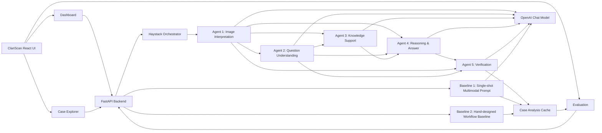

# ClariScan — Agentic Multimodal Medical VQA System

ClariScan is an **agentic multimodal system** for medical visual question answering over radiology images. It combines **image grounding**, **question understanding**, **knowledge support**, **reasoning**, and **verification** into a structured pipeline, then exposes the results through a usable demo UI with **Dashboard**, **Case Explorer**, and **Evaluation** views.

> ⚠️ **For educational and research purposes only. Not for clinical use.**

## Template 1 Fit

This repository is designed to satisfy the requirements of an **Agentic Multimodal System** project:

- **Problem decomposition** into 5 distinct stages
- **Explicit agent architecture** with named roles
- **Multimodal grounding** across image + text
- **Control and failure handling** with verification, fallback, disclaimers, and review flags
- **Evaluation** against two baselines:
  - single-prompt baseline
  - hand-designed non-agentic workflow baseline
- **Failure analysis** using:
  - self-consistency checks
  - cross-modal agreement checks
  - verifier outputs
  - disagreement analysis

## Problem Definition

The target task is **medical visual question answering with explanation**:

- input modality 1: **medical image**
- input modality 2: **natural language question**
- output: **answer, explanation, verification, and failure signals**

This task is intentionally not treated as a single monolithic prompt because the system must separately solve:

- **perception**
- **question interpretation**
- **medical support/context formation**
- **reasoning and synthesis**
- **verification and uncertainty handling**

## Problem Decomposition

ClariScan decomposes the task into 5 explicit stages:

1. **Image Interpretation**
2. **Question Understanding**
3. **Knowledge Support**
4. **Reasoning & Answer**
5. **Verification**

These stages are connected through structured JSON-style intermediate outputs rather than a single end-to-end model call.

## Agent Architecture

### System Diagram



### Agent Roles

| Component | Role |
|---|---|
| `ImageInterpreter` | Perception / multimodal grounding |
| `QuestionAnalyzer` | Task understanding / decomposition |
| `KnowledgeRetriever` | Context support / medical background |
| `ReasoningAgent` | Synthesis / answer generation |
| `VerificationAgent` | Evaluator / safety / uncertainty control |
| `workflow_baseline.py` | Hand-designed non-agentic workflow |
| `baseline.py` | Single-shot baseline |
| `orchestrator.py` | Explicit controller / execution graph |

### Model and Tool Choices

- **OpenAI chat model**
  - used for image interpretation, question analysis, knowledge support, reasoning, and verification
  - supports structured JSON-oriented prompting and easy prompt refinement
  - keeps the implementation simple and consistent across all agents

- **Haystack Pipeline**
  - used for explicit stage orchestration
  - makes intermediate outputs inspectable
  - improves traceability and debugging

- **FastAPI**
  - lightweight API layer for analysis and dataset routes

- **React + Vite**
  - used for a demoable UI with interactive case inspection and evaluation

## Multimodal Grounding

ClariScan uses at least two modalities:

- **image**
- **text**

### How the modalities interact

1. The medical image is converted into structured visual findings.
2. The question is analyzed in the context of the visual summary.
3. Knowledge support is conditioned on visual findings and question type.
4. The final answer is generated using visual evidence, question semantics, and contextual support.
5. The verifier checks whether the answer and explanation are grounded in the image.

This is the core multimodal interaction loop of the system.

## Control and Failure Handling

The system includes several explicit control mechanisms:

- **verification status**
  - `verified`
  - `partially_verified`
  - `low_confidence`
  - `unsupported`

- **fallback behavior**
  - guarded answers
  - safety disclaimers
  - review flags

- **failure categorization**
  - knowledge retrieval failed
  - unsupported claim
  - low confidence
  - visual contradiction
  - question-answer mismatch
  - parser failure
  - reasoning instability

- **agent trace**
  - every stage is timed and exposed in the UI

### Current strategies

- **self-critique / verifier pass**
  - the verification agent critiques the answer after reasoning

- **fallback strategies**
  - disclaimer insertion
  - guarded-answer presentation
  - explicit review recommendation

- **automatic retry**
  - the agentic pipeline performs one prompt-aware retry when the first pass is low confidence, unsupported, or flagged for review
  - the second pass receives retry context so the reasoning stage can self-correct instead of blindly repeating the same answer

The current implementation emphasizes **verification, fallback, and a single retry pass** rather than multi-sample voting.

## Evaluation Design

### Success Criteria

Task success is evaluated primarily by:

- answer correctness against dataset ground truth
- verification quality
- failure/disagreement behavior
- case-level explainability

### Systems Compared

1. **Baseline 1 — Single-shot multimodal baseline**
   - one direct image+question prompt

2. **Baseline 2 — Hand-designed workflow baseline**
   - uses image interpretation + question analysis
   - deterministic, non-agentic decision logic

3. **Agentic pipeline**
   - 5-stage orchestrated system

### Evaluation Views

- **Dashboard**
  - interactive per-case analysis

- **Case Explorer**
  - cached per-sample comparison across systems

- **Evaluation**
  - aggregate metrics from cached runs
  - split-aware (`train` / `test`)
  - question-type breakdown
  - winner analysis
  - self-consistency / cross-modal agreement visibility

### Failure Analysis Signals

The repo explicitly supports:

- **self-consistency checks**
  - derived from verification check agreement

- **cross-modal agreement checks**
  - derived from evidence grounding + contradiction checks

- **verifier model outputs**
  - verification status
  - structured checks
  - fallback recommendations

- **disagreement analysis**
  - disagreement between baseline and agentic outputs
  - comparative winner tracking across baseline / workflow / agentic

## Train/Test Split Usage

The dataset split is inferred from image filenames:

- `train_*` → `train`
- `test_*` → `test`

### Intended usage

- **train**
  - development
  - prompt iteration
  - debugging
  - Case Explorer investigation

- **test**
  - final benchmark reporting
  - trustworthy evaluation
  - final baseline comparison

## UI Demo

The repo includes a usable UI for demonstration:

- **Dashboard**
  - upload or select a case
  - compare agentic / workflow / baseline outputs

- **Case Explorer**
  - browse dataset cases
  - filter by split
  - inspect image, answer, trace, verification, failure modes

- **Evaluation**
  - compare the three systems at aggregate level
  - inspect split counts, wins, accuracy by question type

## Quick Start

### Prerequisites

- Python 3.10+
- Node.js 18+
- OpenAI API key

### 1. Clone and configure

```bash
git clone https://github.com/YOUR_USERNAME/Medical-VQA-Explanation-Agent.git
cd Medical-VQA-Explanation-Agent
cp .env.example .env
```

Add your `OPENAI_API_KEY` to `.env`.
No additional image model settings are required.

### 2. Install Python dependencies

```bash
cd backend
pip install -r requirements.txt
```

### 3. Download VQA-RAD dataset

```bash
python scripts/download_dataset.py
```

### 4. Start the backend

```bash
cd backend
uvicorn main:app --reload --port 8000
```

### 5. Start the frontend

```bash
cd frontend
npm install
npm run dev
```

### 6. Open the app

Navigate to `http://localhost:5173`.

## Usage

1. Upload an image or choose a sample case
2. Ask a medical VQA question
3. Run analysis
4. Compare:
   - **Agentic Pipeline**
   - **Workflow Baseline**
   - **Single-shot Baseline**
5. Use **Case Explorer** for debugging
6. Use **Evaluation** for aggregate metrics and split-aware analysis

## Project Structure

```text
Medical-VQA-Explanation-Agent/
├── backend/
│   ├── main.py
│   ├── config.py
│   ├── agents/
│   │   ├── image_interpreter.py
│   │   ├── question_analyzer.py
│   │   ├── knowledge_retriever.py
│   │   ├── reasoning_agent.py
│   │   ├── verification_agent.py
│   │   ├── orchestrator.py
│   │   ├── baseline.py
│   │   └── workflow_baseline.py
│   ├── routes/
│   │   ├── analyze.py
│   │   └── dataset.py
│   └── utils/
│       └── data_loader.py
├── frontend/
│   └── src/
│       ├── App.jsx
│       ├── index.css
│       ├── components/
│       └── hooks/
├── scripts/
│   └── download_dataset.py
└── README.md
```

## Reflection

### When agentic behavior helps

Agentic behavior is beneficial when:

- the task needs both perception and reasoning
- intermediate state inspection matters
- verification and uncertainty handling matter
- failures need to be localized to specific pipeline stages

For medical VQA, these properties are important because a correct final answer depends on:

- what is visually present
- what the question is actually asking
- whether the explanation is grounded
- whether the answer should be softened or flagged

### Limitations

- the pipeline is slower and more expensive than single-shot inference
- knowledge support can be noisy or fail
- exact-match evaluation is brittle for free-form medical answers
- self-consistency is currently lightweight rather than multi-sample consensus
- the system remains research-oriented and is not suitable for clinical deployment

## Dataset

This project uses **VQA-RAD**:

- 315 radiology images
- 2,248 question-answer pairs
- source: `flaviagiammarino/vqa-rad`

## License

MIT
