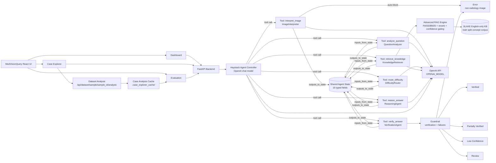
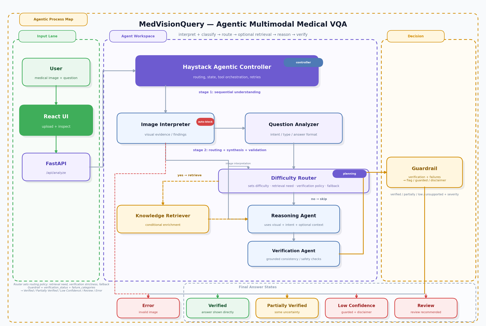

# MedVisionQuery — Agentic Multimodal Medical VQA System

MedVisionQuery is an **agentic multimodal system** for medical visual question answering (VQA) over radiology images. It decomposes the task into 6 specialized agent stages — image interpretation, question understanding, difficulty routing, knowledge support, reasoning, and verification — orchestrated by a **Haystack Agent** with LLM-driven tool selection. The knowledge stage now uses an **Advanced RAG pipeline** backed by an English-only **SLAKE concept KB** with metadata-aware hybrid retrieval, FAISS/BM25 fusion, reranking, and confidence gating. Results are exposed through a demo UI with **Dashboard**, **Case Explorer**, and **Evaluation** views.

> ⚠️ **For educational and research purposes only. Not for clinical use.**

---

## Problem Definition

**Task:** medical visual question answering with explanation

| Input | Type |
|---|---|
| Medical image | User-uploaded medical image (JPEG / PNG); analyzed by the agentic pipeline |
| Natural language question | Any question about the image |

**Output:** structured JSON with answer, explanation, evidence, verification status, confidence, failure signals, and per-stage agent trace.

The task is decomposed rather than single-prompted because the system must separately solve:

1. **Perception** — what is in the image?
2. **Question interpretation** — what is being asked?
3. **Medical context** — what background knowledge applies?
4. **Synthesis** — what is the best-grounded answer?
5. **Verification** — is the answer actually supported?

---

## Three Methods Compared

All three methods use the same medical image and question as input, but they differ in how much structure they impose before producing an answer.

### 1) Single-shot baseline

- Sends the image and question directly to a multimodal model in one prompt
- Produces the answer, explanation, and confidence in a single pass
- Does **not** explicitly separate perception, question analysis, retrieval, or verification
- Best viewed as the simplest lower-bound baseline: fast and easy to run, but least interpretable

### 2) Workflow baseline

- Uses a hand-designed, non-agentic sequence of steps
- First interprets the image, then analyzes the question, then applies fixed branching rules
- Chooses an answer path based on question type, such as:
  - modality identification
  - anatomy identification
  - yes/no or presence-absence questions
  - location questions
  - counting questions
  - abnormality description
  - a fallback path for other question types
- Builds the explanation from structured image and question outputs
- Serves as the required hand-designed workflow baseline: more transparent than the single-shot baseline, but still fixed and non-adaptive

### 3) Agentic pipeline

- Uses a Haystack Agent to coordinate six specialized tools
- Runs image interpretation, question analysis, difficulty routing, optional retrieval, reasoning, and verification as separate stages
- Lets the Difficulty Router decide whether retrieval is needed and how strict verification should be
- Can add disclaimers, flag cases for review, and retry when the first pass is not strong enough
- Is the most expressive and best aligned with the project’s agentic design, but it is also the slowest and most expensive method

---

## Agentic System Design

| Property | Implementation |
|---|---|
| Problem decomposition | 6 distinct agent stages with explicit roles |
| Agent architecture | Named agents wrapped as Haystack Tools; the controller decides tool use over shared state |
| Multimodal grounding | The image is interpreted once, then downstream stages consume structured visual state; OpenAI-backed generators power the agentic stages while Advanced RAG runs locally for retrieval |
| Dynamic tool selection | `retrieve_knowledge` is optional and skipped when the Difficulty Router sets `needs_retrieval=false` |
| Control & failure handling | Verification, guardrails, disclaimers, review flags, failure categories, and automatic retry |
| Evaluation | Against two baselines with normalized answer-match accuracy, token F1, close/open-ended accuracy, and disagreement analysis |

---

## Agent Architecture

### System Diagram

The diagram below shows the **agentic pipeline** only.





### Agent Roles

| Component | File | Role | Model |
|---|---|---|---|
| `ImageInterpreter` | `image_interpreter.py` | Agent 1: Perception — multimodal image interpretation with auto-block for non-radiology images | OpenAI |
| `QuestionAnalyzer` | `question_analyzer.py` | Agent 2: Task understanding — question classification and intent analysis | OpenAI |
| `DifficultyRouter` | `difficulty_router.py` | Agent 3: Planning — sets routing metadata in shared state | OpenAI |
| `KnowledgeRetriever` | `knowledge_retriever.py` | Agent 4: Context — optional Advanced RAG retrieval over the SLAKE English-only concept KB + answer-focused evidence synthesis | OpenAI + local retrieval stack |
| `ReasoningAgent` | `reasoning_agent.py` | Agent 5: Synthesis — generates answer and explanation from all prior context | OpenAI |
| `VerificationAgent` | `verification_agent.py` | Agent 6: Evaluator — grounded consistency / safety checks with 5 structured checks | OpenAI |
| Agent Controller | `orchestrator.py` | Haystack `Agent` — routes tool calls, manages shared state, guardrails, retry | OpenAI |
| Workflow Baseline | `workflow_baseline.py` | Deterministic answer derivation over image/question analysis outputs | Rules + OpenAI intermediates |
| Single-shot Baseline | `baseline.py` | Direct image+question prompt with no decomposition | OpenAI |

### Tool-calling and Shared State

The orchestrator uses Haystack's `Agent` + `Tool` architecture:

- **6 agents** wrapped as `Tool` with `inputs_from_state` / `outputs_to_state` bindings:
  1. `interpret_image` — ImageInterpreter (multimodal)
  2. `analyze_question` — QuestionAnalyzer
  3. `route_difficulty` — DifficultyRouter (sets routing metadata in shared state)
  4. `retrieve_knowledge` — KnowledgeRetriever (conditional, based on `routing_decision.needs_retrieval`)
  5. `reason_answer` — ReasoningAgent
  6. `verify_answer` — VerificationAgent
- The controller LLM decides which tools to invoke and in what order based on prior outputs in state
- **Routing metadata**: DifficultyRouter stores `verification_policy` + `fallback_policy` in `routing_decision`; downstream payloads and UI surfaces read these fields from shared state
- **Auto-block**: ImageInterpreter validates radiology images; non-radiology images abort pipeline early → Error state
- 16 state fields: `image_bytes`, `mime_type`, `question`, `image_interpretation`, `question_analysis`, `routing_decision`, `knowledge`, `answer_data`, `verification_result`, 5 duration fields, `retry_context`
- Exit condition: `verify_answer` finalizes the session
- A fresh `Agent` is created per request to prevent shared mutable state under concurrency

### Dynamic Tool Selection

The `DifficultyRouter` determines the pipeline configuration from question and image context. Policies are strictly mapped by difficulty level:

| Difficulty | `needs_retrieval` | `verification_policy` | `fallback_policy` |
|---|---|---|---|
| `easy` | false | standard | none |
| `medium` | true | standard | add_disclaimer |
| `hard` | true | strict | flag_for_review |

These are routing outcomes, not fixed question-type rules; the actual `DifficultyRouter` also considers image context and question clarity. Typical examples by question type are:

| Question type | Typical difficulty |
|---|---|
| `modality_identification`, `anatomy_identification`, `yes_no`, `counting`, `location` | easy |
| `presence_absence`, `abnormality_description` | medium |
| `explanation_request` (complex clinical reasoning) | hard |

### Knowledge Retrieval (Advanced RAG)

`KnowledgeRetriever` uses `advanced_rag.py` to retrieve supporting SLAKE concept chunks when the router requests retrieval, then uses the OpenAI generator to synthesize the final medical context. The retrieval logic inside `advanced_rag.py` is local and LLM-free: embeddings, FAISS, BM25, and cross-encoder reranking all run on-device.

#### Pipeline Overview

| Stage | Component | Technology | Purpose |
|-------|-----------|------------|---------|
| 1 | **Metadata Pre-filtering** | Inverted indices | Narrow corpus using image-grounded metadata (`modality`, `body_region`, `finding_category`) |
| 2 | **Dense Retrieval** | FAISS + `NeuML/pubmedbert-base-embeddings` | Semantic similarity search on 768-dim normalized biomedical embeddings |
| 3 | **Sparse Retrieval** | BM25Okapi | Lexical matching for exact medical terms |
| 4 | **Hybrid Fusion** | Reciprocal Rank Fusion (RRF) | Merge rankings without score calibration (k=60) |
| 5 | **Cross-encoder Reranking** | `cross-encoder/ms-marco-MiniLM-L-6-v2` | Lightweight relevance scoring (22M params) for fast reranking |
| 6 | **Confidence Gating** | 4-signal thresholding | Accept only high-quality retrievals, reject weak matches |

#### Confidence-Based Validation

The confidence gate acts as a quality filter before evidence reaches the prompt:

| Signal | Threshold | What It Measures |
|--------|-----------|------------------|
| `top1_softmax` | ≥ 0.30 | Cross-encoder certainty about the top candidate |
| `softmax_margin` | ≥ 0.08 | Confidence gap between top-1 and top-2 candidates |
| `dense_top1` | ≥ 0.35 | Semantic retrieval quality (cosine similarity) |
| `agreement` | present in both | Whether the top reranked candidate appears in dense AND sparse top-5 |

**Decision Logic**:
- **High confidence** (0 weak signals): Retrieve and inject evidence
- **Medium confidence** (1 weak signal): Retrieve and log a warning
- **Low confidence** (2+ weak signals): Return empty — no RAG context injected

This prevents low-relevance training cases from contaminating the retrieval context that is later summarized by the LLM.

#### Metadata Filtering

**At Index Time** (corpus building): Metadata is extracted from question+answer text heuristics:
- `modality`: x-ray, ct, mri, ultrasound, etc.
- `body_region`: chest, head, abdomen, musculoskeletal, etc.
- `finding_category`: pneumonia, fracture, mass, hemorrhage, etc.
- `laterality`: left, right, bilateral

**At Query Time**: The pipeline receives metadata from `ImageInterpreter` (vision model output for `modality`, `body_region`) and image-grounded `notable_findings` for `finding_category`. The smart intersection logic inside `advanced_rag.py` is:
1. Start with `modality` when available.
2. Intersect `body_region` when available.
3. Try `finding_category` last.
4. If `finding_category` would reduce candidates to zero, skip it.
5. If `modality ∩ body_region` is empty, fall back to `body_region` alone.

This graceful degradation prevents over-filtering while still using metadata whenever it helps.

### Model Configuration

The current runtime uses OpenAI for all LLM-driven stages. The Advanced RAG retrieval stack additionally uses local SentenceTransformers, a CrossEncoder reranker, FAISS, and BM25 models. The retrieval stack is configured for the English-only SLAKE KB with `NeuML/pubmedbert-base-embeddings` and `cross-encoder/ms-marco-MiniLM-L-6-v2`. The evaluation scorer uses `S-PubMedBert-MS-MARCO` (`pritamdeka/S-PubMedBert-MS-MARCO`) for semantic similarity on open-ended answers.

| Env vars | Used by |
|---|---|
| `OPENAI_API_KEY` | All agents, Haystack controller, `baseline.py` |
| `VISION_MODEL` | `ImageInterpreter`, `baseline.py` |
| `OPENAI_MODEL` | `QuestionAnalyzer`, `KnowledgeRetriever`, `ReasoningAgent`, `VerificationAgent`, Haystack controller |
| `EVALUATION_DEVICE` | Semantic similarity model device selection (`cpu`, `cuda`, or `auto`) |

Hugging Face is used to download the raw datasets via scripts. The retrieval stack itself is local, while the agentic generation steps use OpenAI. Evaluation uses a cached `S-PubMedBert-MS-MARCO` semantic scorer on the backend, prefix-based normalization for yes/no answers, and exact matching for other binary medical assessments such as normal/abnormal and present/absent.

### Other Technology Choices

- **Haystack `Agent` + `Tool`** — controller-managed tool calls with `inputs_from_state` / `outputs_to_state` bindings and per-tool timing
- **FastAPI** — async backend; blocking LLM calls run in `asyncio.to_thread()` to avoid event-loop blocking
- **React 19 + Vite** — frontend UI with Dashboard, Case Explorer, and Evaluation views
- **FAISS (`faiss-cpu`)** — dense vector index for fast semantic retrieval in Advanced RAG
- **SentenceTransformers + CrossEncoder** — dense embeddings and cross-encoder reranking
- **BM25 (`rank-bm25`)** — sparse lexical retrieval for hybrid search
- **Hugging Face `datasets`** — used by `scripts/download_dataset.py` and `scripts/download_slake_dataset.py` to materialize local datasets
- **Matplotlib** — `scripts/system_diagram.py` regenerates `system_diagram.png`

---

## Multimodal Grounding

The system uses **two modalities**: **image** (medical radiology images) and **text** (natural language questions). These modalities interact through a structured pipeline where the image is processed once and its extracted features are consumed by downstream text-based reasoning stages.

- **Image** — converted to base64 PNG and passed as an `ImageContent` block (base64 image + MIME type) to the Haystack vision generator
- **Text** — user's natural language question

### How modalities interact across stages

| Stage | Image used? | Text used? |
|---|---|---|
| Image Interpretation | Base64 vision prompt | Extraction instructions |
| Question Understanding | No | Question + visual summary from stage 1 |
| Knowledge Support | No | `body_region` + `modality` + `visual_cues` from stages 1–2 |
| Reasoning & Answer | No | All prior structured outputs |
| Verification | No | Answer + image analysis + question analysis |

The image is consumed only once (stage 1); all downstream stages operate on the **structured visual summary** extracted from it.

---

## Control and Failure Handling

### Mechanisms for detecting errors or uncertainty

The system detects errors and uncertainty through multiple mechanisms:

1. **VerificationAgent (Agent 6)** — performs 5 structured checks:
   - `answer_matches_question_type`: whether answer format matches expected type
   - `format_appropriate`: whether answer is properly formatted
   - `explanation_grounded_in_evidence`: whether explanation references visible evidence
   - `answer_strength_appropriate`: whether answer strength is appropriate for the question
   - `no_contradictions`: whether answer contains self-contradictory statements

2. **Automatic failure categorization** — detects specific failure modes:
   - `knowledge_retrieval_failed`: RAG retrieval returned no relevant chunks
   - `reasoning_generation_unstable`: answer generation was unstable
   - `unsupported_claim`: answer not grounded in visual evidence
   - `low_confidence`: insufficient evidence for confident answer
   - `partially_verified`: most checks passed with minor uncertainty
   - `visual_contradiction`: answer contradicts image interpretation
   - `question_answer_mismatch`: answer does not address the question
   - `parser_failure`: JSON parsing error in agent output

3. **Analysis signals** — computed from verification results:
   - **Self-consistency signal** — ratio of passed verification checks (high/medium/low)
   - **Cross-modal agreement** — derived from `explanation_grounded_in_evidence` and `no_contradictions` checks

### Retry, self-critique, and fallback strategies

#### Retry with self-critique
- `run_pipeline()` evaluates the first result with `_should_retry_pipeline()`
- Retry triggers on: `low_confidence`, `unsupported`, `should_flag_for_review`, or any high-severity failure
- Second run receives `retry_context` in state (previous status, confidence, failure categories)
- `ReasoningAgent` uses retry context to self-correct its answer generation
- Best result selected by `_payload_score()`: verification rank → confidence rank → severity count → review flag

#### Fallback policies (set by DifficultyRouter)
- **easy** cases: `fallback_policy="none"` — no fallback needed
- **medium** cases: `fallback_policy="add_disclaimer"` — add disclaimer to answer
- **hard** cases: `fallback_policy="flag_for_review"` — flag case for manual review

#### Guardrail logic
The Guardrail combines `verification_status` + `failure_categories` to produce 5 final answer states:

1. **Verified** (`verification_status == "verified"`) — answer shown directly
2. **Partially Verified** (`verification_status == "partially_verified"`) — answer with minor uncertainty
3. **Low Confidence** (`verification_status in {"low_confidence", "unsupported"}`) — guarded answer + disclaimer
4. **Review** (`should_flag_for_review == true` or high-severity failures) — review recommended
5. **Error** (ImageInterpreter auto-block) — non-radiology image rejected

### Verification status levels
| Status | Meaning | Final State |
|---|---|---|
| `verified` | All 5 checks passed | **Verified** — answer shown directly |
| `partially_verified` | Most checks passed with minor uncertainty | **Partially Verified** — some uncertainty noted |
| `low_confidence` | Insufficient evidence for a confident answer | **Low Confidence** — guarded answer + disclaimer |
| `unsupported` | Answer is not grounded in visible evidence | **Low Confidence** — guarded answer + disclaimer |
| `rejected` (image abort) | Non-radiology image detected | **Error** — invalid image type |

- Disclaimer auto-inserted when verifier does not provide one
- `flag_for_review` triggered by high-severity failure categories

### Failure categories (automatically detected)
| Code | Severity |
|---|---|
| `knowledge_retrieval_failed` | medium |
| `reasoning_generation_unstable` | high |
| `unsupported_claim` | high |
| `low_confidence` | high |
| `partially_verified` | medium |
| `visual_contradiction` | high |
| `question_answer_mismatch` | medium |
| `parser_failure` | high |

### Automatic retry
- `run_pipeline()` evaluates the first result with `_should_retry_pipeline()`
- Retry triggers on: `low_confidence`, `unsupported`, `should_flag_for_review`, or any high-severity failure
- Second run receives `retry_context` in state (status, confidence, failure categories) so `ReasoningAgent` can self-correct
- Best result selected by `_payload_score()`: verification rank → confidence rank → severity count → review flag

---

## Evaluation Design

### Task-specific success criteria

The system evaluates success using task-specific criteria that account for the different answer types in medical VQA:

- **Close-ended questions** (yes/no and binary medical assessments): Exact match after normalization
  - Yes/no answers: normalized by trimming punctuation, responses starting with "yes" or "no" count as matches
  - Binary medical assessments (normal/abnormal, present/absent, positive/negative, etc.): exact match only

- **Open-ended questions** (non-binary ground truth): Semantic similarity threshold
  - Uses `S-PubMedBert-MS-MARCO` embeddings for biomedical semantic similarity
  - Threshold ≥ 0.85 cosine similarity for a match
  - Lexical overlap (Token F1) computed as diagnostic metric but not used for accuracy

- **Overall accuracy**: Combines close-ended (exact yes/no) and open-ended (semantic similarity ≥ 0.85) correctness per system

### Metrics computed per cached case
- **Normalized answer match** — evaluation method depends on ground truth answer style:
  - **Close-ended** (yes/no and other binary medical assessments such as normal/abnormal, present/absent, positive/negative): yes/no answers are normalized by trimming punctuation and matching responses that start with `yes` or `no`; other binary medical assessments use exact match only
  - **Open-ended** (non-binary ground truth): `S-PubMedBert-MS-MARCO` semantic similarity ≥ 0.85
- **Yes/no normalization** — responses beginning with `yes` or `no` count as `yes` / `no` after punctuation trimming
- **Semantic similarity** — cosine similarity between answer embeddings using `S-PubMedBert-MS-MARCO`
- **Lexical Overlap (Token F1)** — unigram overlap between predicted and ground-truth answer; diagnostic metric only, NOT used for accuracy
- **Winner** — `baseline` / `workflow` / `agentic` / `tie: ...` / `tie_all_wrong`
- **Disagreement** — whether any two systems produced semantically different answers (`S-PubMedBert-MS-MARCO` similarity < 0.85)

### Aggregate evaluation summary
- Overall accuracy per system (baseline / workflow / agentic) — combines close-ended (exact yes/no) and open-ended (`S-PubMedBert-MS-MARCO`) correctness
- Close-ended and open-ended accuracy per system
- 3-System Disagreement rate — percentage of cases where systems produce semantically different answers
- Win counts, average duration (ms), and per-question-type accuracy breakdown
- Recent-case rows including verification status, self-consistency, and cross-modal agreement

### Cache and evaluation workflow
1. Selecting a sample in Case Explorer runs all 3 systems concurrently via `asyncio.gather` and writes results to `backend/.case_explorer_cache/sample_{id}_{question_hash}.json`
2. Subsequent opens serve from cache — use the **Refresh** button to force a re-run
3. The Evaluation tab reads all cache files and computes the aggregate summary live
4. `scripts/run_case_explorer_cache.py` can warm or inspect the curated Case Explorer cache (`--refresh`, `--all`, `--dry-run`, `--status`)

### Failure case analysis

The system performs failure case analysis using multiple complementary methods:

- **Self-consistency checks** — The VerificationAgent performs 5 structured checks (answer_matches_question_type, format_appropriate, explanation_grounded_in_evidence, answer_strength_appropriate, no_contradictions). The self-consistency signal is computed in `orchestrator.py` (`_build_self_consistency_signal`, lines 475-497) as the ratio of passed checks (high/medium/low) and is displayed in the Evaluation UI.

- **Cross-modal agreement checks** — The system evaluates agreement between the visual interpretation (image modality) and the final answer (text modality). This is computed in `orchestrator.py` (`_build_cross_modal_agreement_signal`, lines 500-513) using VerificationAgent's `explanation_grounded_in_evidence` and `no_contradictions` checks, producing a cross-modal agreement level (high/medium/low) displayed in the Evaluation UI.

- **Verifier models** — Agent 6 (VerificationAgent) serves as the dedicated verifier model, running an OpenAI-backed LLM to perform structured verification of the final answer against the image evidence. The verifier outputs a verification status (verified/partially_verified/low_confidence/unsupported) and identifies specific failure categories.

- **Disagreement analysis** — The system compares outputs across all three methods (baseline, workflow, agentic) using `S-PubMedBert-MS-MARCO` semantic similarity. This is computed in `backend/routes/dataset.py` (`_has_semantic_disagreement`, lines 338-357) with a 0.85 threshold. A 3-system disagreement rate is computed as the percentage of cases where systems produce semantically different answers (similarity < 0.85). The Evaluation UI shows a "Winner" tag (baseline/workflow/agentic/tie) and disagreement status for each case.

These failure analysis signals are displayed in the "Recent Evaluated Cases" table of the Evaluation UI, with columns for verification status, self-consistency level, cross-modal agreement level, and disagreement status.

### Systems compared
| System | File | Approach |
|---|---|---|
| Single-shot baseline | `baseline.py` | Direct multimodal prompting with no explicit decomposition; returns answer, explanation, and confidence in one pass |
| Workflow baseline | `workflow_baseline.py` | Hand-designed non-agentic workflow that interprets the image, analyzes the question, and applies fixed branching rules to derive the answer |
| Agentic pipeline | `orchestrator.py` | 6-tool Haystack Agent with routing, optional retrieval, verification, guardrails, and retry |

---

## Reflection

### When agentic behavior is beneficial

The agentic approach provides value in scenarios where:

- **Dynamic adaptation is needed**: The DifficultyRouter enables adaptive behavior by assessing question complexity and image context. Easy cases (e.g., straightforward yes/no questions on clear images) skip retrieval and use standard verification, reducing unnecessary computation. Medium and hard cases trigger retrieval with appropriate verification strictness, providing external knowledge when needed.

- **Self-correction through retry**: The automatic retry mechanism allows the system to recover from initial failures. When verification indicates low confidence, unsupported claims, or fixable issues, the ReasoningAgent receives retry context (previous status, confidence, failure categories) and can self-correct its answer generation. Logs show cases where retry improved the final result.

- **Structured verification improves reliability**: The VerificationAgent's 5 structured checks (answer_matches_question_type, format_appropriate, explanation_grounded_in_evidence, answer_strength_appropriate, no_contradictions) catch inconsistencies that single-prompt approaches might miss. This is particularly valuable for medical applications where answer accuracy and grounding are critical.

- **Knowledge retrieval for complex queries**: The Advanced RAG pipeline provides external medical knowledge from the SLAKE concept KB for cases requiring broader context. This is beneficial for explanation requests, ambiguous questions, or cases where the image alone is insufficient.

- **Quality signals for transparency**: Self-consistency and cross-modal agreement signals provide interpretable quality indicators, allowing users to understand when answers are well-grounded versus when they should be treated with caution.

### Limitations of the approach

The agentic approach has several trade-offs:

- **Significantly higher latency**: The agentic pipeline takes 13-31 seconds per query (logs show total_duration), compared to 1-4 seconds for the single-shot baseline and 3-5 seconds for the workflow baseline. This is due to the 6 sequential stages, each requiring an LLM call. When retry is triggered, latency can double (logs show 34-41 seconds for retried cases). Analysis of 21 samples from medvqa_20260410 logs shows agentic is 7.3-23x slower than baseline (average ~11x slower).

- **Higher computational cost**: Multiple LLM API calls per query (6 stages, plus potential retry) increase cost compared to single-prompt baselines. This makes the approach more expensive to operate at scale.

- **Over-engineering for simple cases**: Even "easy" cases routed by the DifficultyRouter still go through multiple stages (image interpretation, question analysis, routing, reasoning, verification). For simple visual recognition tasks, a single-prompt approach may be sufficient and more efficient.

- **Dependency on routing quality**: The system's adaptive behavior depends on the DifficultyRouter's accuracy. If the router misclassifies difficulty, it may skip retrieval when needed or invoke it unnecessarily, affecting both performance and cost.

- **Still prone to errors**: Despite verification and retry mechanisms, the system can still produce incorrect answers. Logs show cases where the agentic pipeline failed while baselines succeeded (e.g., sample 1857: agentic answered "no" but ground truth was "yes"). The verification checks are heuristics and may not catch all errors.

- **Complexity increases debugging**: With 6 stages, multiple LLM calls, and dynamic routing, debugging failures is more complex than in single-prompt approaches. Pinpointing the source of errors requires examining the full agent trace and intermediate outputs.

- **RAG corpus limitations**: The Advanced RAG pipeline depends on the quality and coverage of the SLAKE knowledge base. The KB contains 366 English-only concept chunks aggregated from 4,919 SLAKE train-split QA pairs. This small corpus size may limit coverage for diverse medical queries. Strict confidence thresholds (top1_softmax ≥ 0.30, softmax_margin ≥ 0.08, dense_top1 ≥ 0.35) can cause retrieval failures even when some relevant chunks exist. Logs show that when retrieval is triggered (medium/hard difficulty), it typically retrieves 3 similar cases with 4-5 key facts in 3.8-5 seconds, but some queries return 0 candidates due to low confidence scores. Some retrieved cases have low or negative rerank scores, suggesting the KB may not always have highly relevant matches. Additionally, the "knowledge_retrieval_failed" failure category can be triggered even when retrieval was not expected by routing (needs_retrieval=False), indicating the failure detection logic may be overly sensitive in some cases.

---

## API Reference

All endpoints served at `http://localhost:8000`.

| Method | Path | Description |
|---|---|---|
| `GET` | `/` | Health check, lists all endpoints |
| `POST` | `/api/analyze` | Run full agentic pipeline |
| `POST` | `/api/analyze/baseline` | Run single-shot baseline |
| `POST` | `/api/analyze/workflow` | Run workflow baseline |
| `GET` | `/api/dataset/samples` | List **test-split only** dataset samples (balanced across question-type categories) |
| `GET` | `/api/dataset/sample/{id}` | Get sample with base64-encoded image |
| `GET` | `/api/dataset/sample/{id}/analysis?refresh=false` | Run all 3 systems on a sample, cache result |
| `GET` | `/api/dataset/evaluation` | Aggregate evaluation metrics from all cached analyses |

`POST /api/analyze*` endpoints accept `multipart/form-data` with fields `image` (file) and `question` (string).

---

## UI

### Dashboard
Purpose: **ad-hoc analysis of any uploaded image**.

Three-panel layout:

- **Case Input (left)** — Image upload via drag-drop or click, question text area, Clear and Analyze buttons, educational disclaimer
- **Image Workspace (center)** — Image display with predicted modality/body-region tags; comparison toggle appears here when results exist
- **AI Analysis (right)** — Results panel showing one of three comparison views:
  - **Agentic Pipeline** — `AnswerCard`, `ExplanationCard`, `AgentTrace` (stage timeline), `RoutingCard` (difficulty/retrieval), `VerificationPanel` (5-check verification), `FailureModeDrawer`
  - **Single-shot Baseline** — Simplified result card with answer, explanation, confidence tag, and educational note
  - **Workflow Baseline** — Simplified result card with answer, explanation, confidence tag, and workflow note

All 3 systems run in parallel; results populate as each completes. Toggle between views using the comparison toggle in the Image Workspace header.

### Case Explorer
Purpose: **systematic browsing and analysis of the VQA-RAD dataset**.

Three-panel layout:

- **Sample Cases (left)** — Dropdown grouped by question-type category (anatomy identification, modality identification, yes/no, counting, location, abnormality description, other); selected case card shows ID, question, ground truth answer, and question type; Refresh and Clear buttons
- **Case Preview (center)** — Methodology labels (3-column summary of Agentic/Workflow/Baseline approaches); image display; **Case Summary** card with:
  - **Overview** — selected sample ID, current view, duration per system
  - **Agentic Quality** (agentic view only) — confidence, verification status, self-consistency, cross-modal agreement, review flag, issue count
  - **Routing & Retrieval** (agentic view only) — difficulty (easy/medium/hard), knowledge retriever trigger status, verification policy, fallback policy, key facts count, routing rationale
- **Case Analysis (right)** — Same component set as Dashboard (`AnswerCard`, `ExplanationCard`, `AgentTrace`, `VerificationPanel`, `FailureModeDrawer`) with agentic details, or simplified cards for baseline/workflow views

Features:
- Browse **test-split only** samples (default 200, balanced across question types) grouped by question type with deterministic ordering
- Comparison toggle with per-system timing badges (agentic/workflow/baseline durations)
- Sample IDs visible in dropdown options for easy reference
- Cache-aware analysis with Refresh button to force re-run

### Evaluation
Purpose: **aggregate performance comparison across all cached analyses**.

Reads all cached Case Explorer results automatically and displays:

- **System Performance Cards** — Overall accuracy (Exact yes/no + `S-PubMedBert-MS-MARCO`), average runtime, and total runtime for Baseline, Workflow, and Agentic
- **Metrics Grid** — Total cases, 3-system disagreement rate, lexical overlap (Token F1), win counts per system, close-ended accuracy (exact yes/no), semantic similarity accuracy (open-ended, threshold ≥ 0.85)
- **Breakdown Table** — Dropdown selector for two modes:
  - **Question Type** — Flat list with accuracy bars per question category
  - **Difficulty Type** — Expandable parent rows (easy/medium/hard) with nested question-type breakdowns; reflects Difficulty Router policy (retrieval trigger, verification strictness, fallback)
- **Recent Evaluated Cases** — Filterable table with columns:
  - Sample ID, question, ground truth, and question type tags (original vs agentic-reclassified)
  - All three system answers
  - Winner tag (baseline/workflow/agentic/tie)
  - **Routing** — Difficulty badge, knowledge retriever trigger, verification policy
  - Agentic retriever status, verification status
  - Agentic signals (self-consistency level, cross-modal agreement)
  - Runtime per system
  - Sample ID multi-select filter (up to 5 IDs)

Hit **Refresh Metrics** to re-aggregate after running new cases in Case Explorer.

---

## Dataset

**VQA-RAD** — a publicly available radiology VQA benchmark from [flaviagiammarino/vqa-rad](https://huggingface.co/datasets/flaviagiammarino/vqa-rad) on Hugging Face.

| Field | Value |
|---|---|
| QA pairs in local manifest | 2,244 total |
| Split breakdown | 1,793 train / 451 test |
| Generated image files | 2,244 PNGs under `data/vqa-rad/images/` |
| Image types | Radiology images |
| Question styles | Yes/no (close-ended) and open-ended |

**SLAKE** — a medical VQA dataset from [BoKelvin/SLAKE](https://huggingface.co/datasets/BoKelvin/SLAKE) on Hugging Face.

| Field | Value |
|---|---|
| KB source | Train split only |
| Downloaded manifest | `data/slake/slake.json` |
| KB output | `data/slake/kb/slake_kb.jsonl` / `.json` / `_summary.json` |
| Retrieval corpus | 366 English-only concept chunks |
| Retrieval models | `NeuML/pubmedbert-base-embeddings` + `cross-encoder/ms-marco-MiniLM-L-6-v2` |

VQA-RAD is used for the app's Case Explorer browsing and evaluation cache. SLAKE train split is used as the retrieval corpus for the Advanced RAG pipeline — no VQA-RAD cases are used in the retrieval index.

The evaluation scorer uses exact `yes` / `no` matching for close-ended questions and `S-PubMedBert-MS-MARCO` semantic similarity with a 0.85 threshold for open-ended questions.

The download scripts flatten the Hugging Face datasets into local manifests with split labels, and local image filenames are saved as `{split}_{index:04d}.png`.

### SLAKE Data Pipeline

The SLAKE dataset goes through a transformation process to create a concept-level knowledge base for RAG:

1. **Download SLAKE dataset** (`scripts/download_slake_dataset.py`)
   - Downloads from Hugging Face: `BoKelvin/SLAKE`
   - Total: 14,028 items (9,835 train / 2,099 validation / 2,099 test)
   - Outputs: `data/slake/slake.json` with fields: id, split, question, answer, answer_type, image_name, lang, modality

2. **Build SLAKE KB** (`scripts/build_slake_kb.py --language en`)
   - Filters to train split only: 4,919 rows
   - Filters to English-only: 4,919 rows
   - Extracts metadata from each row (concept type, concept label, modality, body region, finding category, laterality, visual cues, target entity)
   - Aggregates by concept signature (concept_type, concept, modality, body_region, finding_category, laterality, answer_type, language)
   - 4,919 rows → 366 unique concept chunks
   - Each chunk aggregates similar QA pairs around one medical concept
   - Includes `support_count` (how many original rows contributed) and sample questions/answers for context
   - Outputs: `data/slake/kb/slake_kb.jsonl`, `slake_kb.json`, `slake_kb_summary.json`

The aggregation is intentional — creates a concept-level knowledge base for retrieval rather than raw QA pairs. Each chunk represents a unique medical concept with aggregated evidence from multiple similar questions.

---

## Quick Start

### Prerequisites

- Python 3.12
- Node.js 18+
- OpenAI API key with access to the selected `OPENAI_MODEL`

### 1. Clone and configure

```bash
git clone https://github.com/YOUR_USERNAME/Medical-VQA-Explanation-Agent.git
cd Medical-VQA-Explanation-Agent
cp .env.example .env
```

Edit `.env`:
```env
OPENAI_API_KEY=sk-...
VISION_MODEL=gpt-5.4-mini-2026-03-17
OPENAI_MODEL=gpt-5.4-mini-2026-03-17
HF_TOKEN=hf_...

# Frontend origin allowed by CORS
BACKEND_CORS_ORIGINS=http://localhost:5173
```

Optional: create `frontend/.env` if the frontend should point to a non-default backend URL.
```env
VITE_API_BASE=http://localhost:8000
```

Note: For local browser access, `BACKEND_CORS_ORIGINS` should include the frontend origin (for example, `http://localhost:5173`). `HF_TOKEN` is optional but can help avoid Hugging Face Hub rate-limit warnings during dataset/model downloads.

### 2. Install Python dependencies

**Option A — conda (recommended)**
```bash
conda env create -f environment.yml
conda activate medvisionquery
```

This path installs native ML dependencies (`numpy`, `faiss-cpu`, `pytorch`) from conda first, then installs Python-level packages with pip. This is the recommended setup to avoid OpenMP runtime conflicts on Windows.

**Option B — pip (fallback, more fragile for native deps on Windows)**
```bash
pip install -r backend/requirements.txt
```

If you use the pip fallback, install native packages from conda first in the same environment:
```bash
conda install -c conda-forge numpy faiss-cpu pytorch
pip install -r backend/requirements.txt
```

### 3. Download the datasets

```bash
python scripts/download_dataset.py
python scripts/download_slake_dataset.py
```

Downloads the VQA-RAD case-evaluation dataset and the SLAKE dataset from Hugging Face. VQA-RAD is used for the app's dataset browser and evaluation cache, while SLAKE is converted into the English-only retrieval KB used by Advanced RAG.

To build the SLAKE KB after download:

```bash
python scripts/build_slake_kb.py --language en
```

This writes `data/slake/kb/slake_kb.jsonl`, `slake_kb.json`, and `slake_kb_summary.json`.

### 4. Start the backend

```bash
cd backend
uvicorn main:app --reload --port 8000
```

### 5. Start the frontend

```bash
cd frontend
npm install
npm run dev
```

### 6. Open the app

Navigate to `http://localhost:5173`.

---

## Project Structure

```text
Medical-VQA-Explanation-Agent/
├── .env.example                     # env template (OpenAI credentials and CORS)
├── environment.yml                  # conda environment (Python 3.12 + pip dependencies)
├── backend/
│   ├── main.py                      # FastAPI app, CORS middleware, router registration
│   ├── config.py                    # loads .env: OPENAI_API_KEY, OPENAI_MODEL, VISION_MODEL, HF_TOKEN, DATA_DIR, CORS
│   ├── logger.py                    # structured logging: get_logger(), per-sample file handler, log rotation
│   ├── requirements.txt             # pip dependencies
│   ├── agents/
│   │   ├── orchestrator.py          # Haystack Agent controller, tool routing, retry logic, guardrails
│   │   ├── image_interpreter.py     # Agent 1: multimodal image interpretation (OpenAI-backed vision model)
│   │   ├── question_analyzer.py     # Agent 2: question classification and intent analysis (OpenAI)
│   │   ├── difficulty_router.py     # Agent 3: planning — sets difficulty, retrieval flag, verification policy, fallback policy
│   │   ├── advanced_rag.py          # Advanced RAG engine: SLAKE KB retrieval, metadata filtering, reranking, confidence gating
│   │   ├── knowledge_retriever.py   # Agent 4: optional medical context retrieval with SLAKE KB grounding
│   │   ├── reasoning_agent.py       # Agent 5: answer synthesis with retry context support (OpenAI)
│   │   ├── verification_agent.py    # Agent 6: structured verification and fallback recommendations (OpenAI)
│   │   ├── baseline.py              # Single-shot multimodal baseline (OpenAI)
│   │   └── workflow_baseline.py     # Deterministic answer derivation over image/question analysis outputs
│   ├── routes/
│   │   ├── analyze.py               # POST /api/analyze, /baseline, /workflow
│   │   └── dataset.py               # GET /api/dataset/* — samples, analysis, evaluation, cache
│   └── utils/
│       ├── data_loader.py           # VQA-RAD JSON loader, sample bucketing, question classification
│       └── json_utils.py            # strip_json_fences() — removes markdown code fences from LLM output
├── frontend/
│   ├── package.json                 # React 19 + Vite app
│   └── src/
│       ├── main.jsx                 # React entry point
│       ├── App.jsx                  # root component, tab routing (Dashboard / Case Explorer / Evaluation)
│       ├── config.js                # API base URL (`VITE_API_BASE` override)
│       ├── index.css                # custom CSS (no framework)
│       ├── components/
│       │   ├── AgentTrace.jsx       # stage timeline, status badges, expandable outputs
│       │   ├── AnswerCard.jsx       # final answer, guarded answer, confidence, disclaimer
│       │   ├── CaseExplorer.jsx     # dataset browser and cached 3-system case comparison
│       │   ├── CaseHeader.jsx       # case metadata summary bar
│       │   ├── CaseInput.jsx        # image upload + question input (Dashboard)
│       │   ├── ComparisonToggle.jsx # switch between agentic / workflow / baseline result views
│       │   ├── ConfidenceBadge.jsx  # High / Medium / Low confidence badge
│       │   ├── EvaluationView.jsx   # aggregate metrics, close/open-ended accuracy, recent cases
│       │   ├── ExplanationCard.jsx  # explanation text, evidence used, reasoning trace
│       │   ├── FailureModeDrawer.jsx# collapsible failure category list and failure hints
│       │   ├── ImageViewer.jsx      # image display with zoom and predicted tags
│       │   ├── RoutingCard.jsx      # difficulty badge, retrieval trigger, verification policy, fallback policy
│       │   └── VerificationPanel.jsx# verification checks, notes, fallback, review flag
│       └── hooks/
│           ├── useAnalysis.js       # analyze / analyzeBaseline / analyzeWorkflow API calls
│           ├── useDataset.js        # sample listing + fetchSampleAnalysis
│           └── useEvaluation.js     # evaluation summary fetch
├── scripts/
│   ├── download_dataset.py          # downloads VQA-RAD from Hugging Face, writes JSON + images
│   ├── download_slake_dataset.py    # downloads SLAKE from Hugging Face, writes JSON + images + language labels
│   ├── build_slake_kb.py            # builds the English-only SLAKE concept KB for retrieval
│   ├── run_case_explorer_cache.py   # warms/inspects the curated Case Explorer cache
│   ├── system_diagram.py            # regenerates the architecture figure
├── system_diagram.png               # rendered system diagram asset
├── eval-dashboard-screenshots/      # UI screenshots of the evaluation dashboard
└── data/
    ├── vqa-rad/                     # gitignored — created by download_dataset.py
    │   ├── vqa_rad.json             # flattened QA manifest with split labels and image filenames
    │   └── images/                  # PNG images named {split}_{index:04d}.png
    └── slake/                       # gitignored — created by download_slake_dataset.py / build_slake_kb.py
        ├── slake.json               # flattened SLAKE manifest with language labels
        ├── images/                  # PNG images named {split}_{index:04d}.png
        └── kb/                      # English-only concept KB JSONL/JSON + summary files
```

---

## Appendix: Agent Outputs (Representative JSON Payloads)

The following shapes describe the main inner `result` payload returned by each Haystack component. In the actual implementation, each agent returns `{"result": ...}` and may also include `status`, `error`, or extra wrapper metadata on success/failure.

### ImageInterpreter
```json
{
  "status": "success | error",
  "is_radiology_image": true,
  "modality": "X-ray",
  "body_region": "chest",
  "visible_structures": ["lungs", "ribs", "heart"],
  "visual_summary": "...",
  "image_quality": "good | fair | poor",
  "notable_findings": ["..."]
}
```

### QuestionAnalyzer
```json
{
  "status": "success | error",
  "question_type": "anatomy_identification | modality_identification | presence_absence | location | counting | abnormality_description | explanation_request | yes_no | other",
  "target_entity": "...",
  "reasoning_type": "visual_recognition | spatial_reasoning | medical_knowledge | comparison | descriptive",
  "expected_answer_format": "single_word | short_phrase | yes_no | sentence | paragraph",
  "requires_medical_knowledge": true,
  "question_clarity": "clear | ambiguous | unclear",
  "rephrased_question": "..."
}
```

### DifficultyRouter
```json
{
  "status": "success | error",
  "difficulty": "easy | medium | hard",
  "needs_retrieval": true,
  "retrieval_rationale": "...",
  "verification_policy": "standard | strict",
  "fallback_policy": "none | add_disclaimer | flag_for_review",
  "routing_rationale": "..."
}
```

### KnowledgeRetriever
```json
{
  "status": "success | error",
  "contextual_notes": "...",
  "key_facts": ["..."],
  "expected_normal_findings": "...",
  "common_pathologies": ["..."],
  "terminology": {"term": "definition"},
  "rag_retrieval": {
    "similar_cases": ["..."],
    "metadata": {"count": 0, "triggered": true}
  }
}
```

### ReasoningAgent
```json
{
  "status": "success | error",
  "answer": "...",
  "explanation": "...",
  "reasoning_trace": "...",
  "evidence_used": ["..."],
  "answer_confidence": "high | medium | low",
  "limitations": "..."
}
```

### VerificationAgent — 5 explicit checks
```json
{
  "status": "success | error",
  "verification_status": "verified | partially_verified | low_confidence | unsupported",
  "confidence_label": "High | Medium | Low",
  "checks": {
    "answer_matches_question_type": true,
    "explanation_grounded_in_evidence": true,
    "answer_strength_appropriate": true,
    "no_contradictions": true,
    "format_appropriate": true
  },
  "issues_found": ["..."],
  "fallback_recommendation": "none | rephrase_answer | add_disclaimer | flag_for_review",
  "verification_notes": "...",
  "suggested_disclaimer": "..."
}
```

---

## License

MIT
