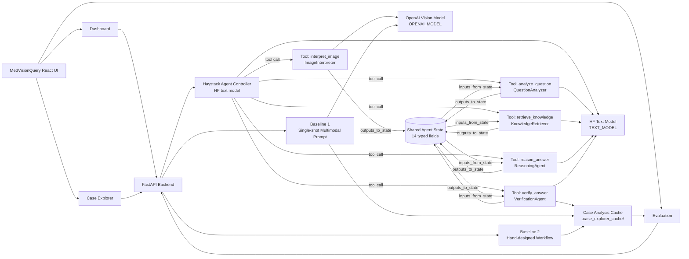

# MedVisionQuery — Agentic Multimodal Medical VQA System

MedVisionQuery is an **agentic multimodal system** for medical visual question answering (VQA) over radiology images. It decomposes the task into 5 specialized agent stages — image interpretation, question understanding, knowledge support, reasoning, and verification — orchestrated by a **Haystack Agent** with LLM-driven tool selection. Results are exposed through a demo UI with **Dashboard**, **Case Explorer**, and **Evaluation** views.

> ⚠️ **For educational and research purposes only. Not for clinical use.**

---

## Agentic System Design

| Property | Implementation |
|---|---|
| Problem decomposition | 5 distinct agent stages with explicit roles |
| Agent architecture | Named agents wrapped as Haystack Tools; LLM controller decides execution order |
| Multimodal grounding | Vision model for image interpretation; text model for all downstream reasoning |
| Dynamic tool selection | `retrieve_knowledge` skipped for simple questions by the controller |
| Control & failure handling | Verification, guardrails, disclaimers, review flags, automatic retry |
| Evaluation | Against two baselines with exact match, token F1, and disagreement analysis |

---

## Problem Definition

**Task:** medical visual question answering with explanation

| Input | Type |
|---|---|
| Medical image | Radiology / pathology image (JPEG / PNG) |
| Natural language question | Any question about the image |

**Output:** structured JSON with answer, explanation, evidence, verification status, confidence, failure signals, and per-stage agent trace.

The task is decomposed rather than single-prompted because the system must separately solve:

1. **Perception** — what is in the image?
2. **Question interpretation** — what is being asked?
3. **Medical context** — what background knowledge applies?
4. **Synthesis** — what is the best-grounded answer?
5. **Verification** — is the answer actually supported?

---

## Agent Architecture

### System Diagram



### Agent Roles

| Component | File | Role | Model |
|---|---|---|---|
| `ImageInterpreter` | `image_interpreter.py` | Perception — multimodal vision, extracts visual findings | Vision (OpenAI) |
| `QuestionAnalyzer` | `question_analyzer.py` | Task understanding — classifies question type and intent | Text (HF) |
| `KnowledgeRetriever` | `knowledge_retriever.py` | Context — retrieves medical background; **dynamically skipped** for simple questions | Text (HF) |
| `ReasoningAgent` | `reasoning_agent.py` | Synthesis — generates answer and explanation from all prior context | OpenAI |
| `VerificationAgent` | `verification_agent.py` | Evaluator — runs 5 structured checks on the answer | OpenAI |
| Agent Controller | `orchestrator.py` | Haystack `Agent` — routes tool calls via LLM, manages shared state | Text (HF) |
| Workflow Baseline | `workflow_baseline.py` | Deterministic rule-based answer logic using image + question analysis outputs | Rules only |
| Single-shot Baseline | `baseline.py` | Direct image+question prompt with no decomposition | Vision (OpenAI) |

### Tool-calling and Shared State

The orchestrator uses Haystack's `Agent` + `Tool` architecture:

- Each agent is wrapped as a `Tool` with `inputs_from_state` / `outputs_to_state` bindings
- The controller LLM decides which tools to invoke and in what order based on prior outputs in state
- 14 state fields: `image_bytes`, `mime_type`, `question`, `image_interpretation`, `question_analysis`, `knowledge`, `answer_data`, `verification_result`, 5 duration fields, `retry_context`
- Exit condition: `verify_answer` finalizes the session
- A fresh `Agent` is created per request to prevent shared mutable state under concurrency

### Dynamic Tool Selection

The controller uses `question_type` from `QuestionAnalyzer` to decide whether to invoke `KnowledgeRetriever`:

| Question type | `retrieve_knowledge` called? |
|---|---|
| `modality_identification`, `anatomy_identification`, `presence_absence`, `location`, `counting`, `yes_no` | No — skipped |
| `abnormality_description`, `explanation_request` | Yes |
| When `requires_medical_knowledge` is true | Yes |

### Model Split

Two separate model configs are required:

| Role | Env vars | Used by |
|---|---|---|
| **OpenAI model** — quality-critical stages | `OPENAI_API_KEY`, `OPENAI_MODEL` | `ImageInterpreter`, `ReasoningAgent`, `VerificationAgent`, `baseline.py` |
| **HF text model** — structured / support stages | `HF_TOKEN`, `TEXT_MODEL`, `TEXT_MODEL_BASE_URL` | `QuestionAnalyzer`, `KnowledgeRetriever`, orchestrator |

OpenAI handles the stages whose output quality is most visible — vision grounding, final answer synthesis, and the verification quality gate. The HF router handles the more structured, lower-stakes tasks: question classification, background context retrieval, and tool-call orchestration.

### Other Technology Choices

- **Haystack `Agent` + `Tool`** — controller LLM decides tool calls; `inputs_from_state` / `outputs_to_state` replaces explicit data-wiring; per-tool timing via `time.time()`
- **FastAPI** — async backend; all blocking LLM calls run in `asyncio.to_thread()` to avoid event-loop blocking
- **React 19 + Vite** — frontend UI, custom CSS only (no UI framework)

---

## Multimodal Grounding

- **Image** — converted to base64 PNG, passed as `image_url` content block to the vision model
- **Text** — user's natural language question

### How modalities interact across stages

| Stage | Image used? | Text used? |
|---|---|---|
| Image Interpretation | ✅ Base64 vision prompt | ✅ Extraction instructions |
| Question Understanding | ❌ | ✅ Question + visual summary from stage 1 |
| Knowledge Support | ❌ | ✅ `body_region` + `modality` + `visual_cues` from stages 1–2 |
| Reasoning & Answer | ❌ | ✅ All prior structured outputs |
| Verification | ❌ | ✅ Answer + image analysis + question analysis |

The image is consumed only once (stage 1); all downstream stages operate on the **structured visual summary** extracted from it.

---

## Agent Outputs (JSON Contracts)

### ImageInterpreter
```json
{
  "modality": "X-ray",
  "body_region": "chest",
  "visible_structures": ["lungs", "ribs", "heart"],
  "visual_summary": "...",
  "image_quality": "good | fair | poor",
  "notable_findings": ["..."]
}
```

### QuestionAnalyzer
```json
{
  "question_type": "anatomy_identification | modality_identification | presence_absence | location | counting | abnormality_description | explanation_request | yes_no | other",
  "target_entity": "...",
  "reasoning_type": "visual_recognition | spatial_reasoning | medical_knowledge | comparison | descriptive",
  "expected_answer_format": "single_word | short_phrase | yes_no | sentence | paragraph",
  "requires_medical_knowledge": true,
  "question_clarity": "clear | ambiguous | unclear",
  "rephrased_question": "..."
}
```

### KnowledgeRetriever
```json
{
  "contextual_notes": "...",
  "key_facts": ["..."],
  "expected_normal_findings": "...",
  "common_pathologies": ["..."],
  "terminology": {"term": "definition"}
}
```

### ReasoningAgent
```json
{
  "answer": "...",
  "explanation": "...",
  "reasoning_trace": "...",
  "evidence_used": ["..."],
  "answer_confidence": "high | medium | low",
  "limitations": "..."
}
```

### VerificationAgent — 5 explicit checks
```json
{
  "verification_status": "verified | partially_verified | low_confidence | unsupported",
  "confidence_label": "High | Medium | Low",
  "checks": {
    "answer_matches_question_type": true,
    "explanation_grounded_in_evidence": true,
    "answer_strength_appropriate": true,
    "no_contradictions": true,
    "format_appropriate": true
  },
  "issues_found": ["..."],
  "fallback_recommendation": "none | rephrase_answer | add_disclaimer | flag_for_review",
  "verification_notes": "...",
  "suggested_disclaimer": "..."
}
```

---

## Control and Failure Handling

### Verification status levels
| Status | Meaning |
|---|---|
| `verified` | All 5 checks passed |
| `partially_verified` | Most checks passed with minor uncertainty |
| `low_confidence` | Insufficient evidence for a confident answer |
| `unsupported` | Answer is not grounded in visible evidence |

### Guardrail logic
- `low_confidence` or `unsupported` → answer replaced with a guarded response + disclaimer
- `flag_for_review` or any high-severity failure category → `should_flag_for_review = true`
- Disclaimer auto-inserted when the verifier does not provide one

### Failure categories (automatically detected)
| Code | Severity |
|---|---|
| `knowledge_retrieval_failed` | medium |
| `reasoning_generation_unstable` | high |
| `unsupported_claim` | high |
| `low_confidence` | high |
| `partially_verified` | medium |
| `visual_contradiction` | high |
| `question_answer_mismatch` | medium |
| `parser_failure` | high |

### Analysis signals
- **Self-consistency signal** — ratio of passed verification checks (`high` / `medium` / `low`)
- **Cross-modal agreement** — derived from `explanation_grounded_in_evidence` and `no_contradictions`

### Automatic retry
- `run_pipeline()` evaluates the first result with `_should_retry_pipeline()`
- Retry triggers on: `low_confidence`, `unsupported`, `should_flag_for_review`, or any high-severity failure
- Second run receives `retry_context` in state (status, confidence, failure categories) so `ReasoningAgent` can self-correct
- Best result selected by `_payload_score()`: verification rank → confidence rank → severity count → review flag

---

## Evaluation Design

### Metrics computed per cached case
- **Exact match** — normalized answer string comparison
- **Yes/no normalization** — `yes/true/present/positive` → `yes`; `no/false/absent/negative/normal` → `no`
- **Token F1** — unigram overlap between predicted and ground-truth answer
- **Winner** — `baseline` / `workflow` / `agentic` / `tie_multi_correct` / `tie_all_wrong`
- **Disagreement** — whether any two systems produced different answers

### Aggregate evaluation summary
- Overall exact-match accuracy per system (baseline / workflow / agentic)
- Win counts and disagreement rate
- Average duration (ms)
- Per-question-type accuracy breakdown

### Cache and evaluation workflow
1. Selecting a sample in Case Explorer runs all 3 systems concurrently via `asyncio.gather` and writes results to `backend/.case_explorer_cache/sample_{id}_{question_hash}.json`
2. Subsequent opens serve from cache — use the **Refresh** button to force a re-run
3. The Evaluation tab reads all cache files and computes the aggregate summary live

### Systems compared
| System | File | Approach |
|---|---|---|
| Single-shot baseline | `baseline.py` | One multimodal prompt, no decomposition — answer + explanation + confidence |
| Workflow baseline | `workflow_baseline.py` | Deterministic rule-based logic per question type; reuses LLM image + question outputs only |
| Agentic pipeline | `orchestrator.py` | 5-tool Haystack Agent with LLM controller, verification, guardrails, retry |

---

## API Reference

All endpoints served at `http://localhost:8000`.

| Method | Path | Description |
|---|---|---|
| `GET` | `/` | Health check, lists all endpoints |
| `POST` | `/api/analyze` | Run full agentic pipeline |
| `POST` | `/api/analyze/baseline` | Run single-shot baseline |
| `POST` | `/api/analyze/workflow` | Run workflow baseline |
| `GET` | `/api/dataset/samples?limit=N` | List dataset samples (balanced across question types) |
| `GET` | `/api/dataset/sample/{id}` | Get sample with base64-encoded image |
| `GET` | `/api/dataset/sample/{id}/analysis?refresh=false` | Run all 3 systems on a sample, cache result |
| `GET` | `/api/dataset/evaluation` | Aggregate evaluation metrics from all cached analyses |

`POST /api/analyze*` endpoints accept `multipart/form-data` with fields `image` (file) and `question` (string).

---

## UI

### Dashboard
Purpose: **ad-hoc analysis of any uploaded image**.

- Upload a medical image and type a question
- All 3 systems run in parallel; results appear as each completes
- Toggle between Agentic Pipeline / Workflow Baseline / Single-shot Baseline views
- Components: `CaseInput`, `ImageViewer`, `AnswerCard`, `ExplanationCard`, `AgentTrace`, `VerificationPanel`, `FailureModeDrawer`, `ConfidenceBadge`

### Case Explorer
Purpose: **systematic browsing and analysis of the VQA-RAD dataset**.

- Browse all dataset samples with question type labels
- Select a sample to load its image and pre-filled question
- Run full 3-system analysis with cache awareness (Refresh to force re-run)
- Inspect ground truth, all 3 answers, agent trace, verification, and failure modes side-by-side

### Evaluation
Purpose: **aggregate performance comparison across all cached analyses**.

- Reads all cached Case Explorer results automatically
- Displays exact-match accuracy, win counts, disagreement rate, and average duration per system
- Per-question-type accuracy breakdown table
- Hit **Refresh** to re-aggregate after running new cases in Case Explorer

---

## Quick Start

### Prerequisites

- Python 3.12
- Node.js 18+
- OpenAI API key (vision-capable model)
- Hugging Face token (for text model routing)

### 1. Clone and configure

```bash
git clone https://github.com/YOUR_USERNAME/Medical-VQA-Explanation-Agent.git
cd Medical-VQA-Explanation-Agent
cp .env.example .env
```

Edit `.env`:
```env
# Vision model — ImageInterpreter and single-shot baseline
OPENAI_API_KEY=sk-...
OPENAI_MODEL=gpt-4o-mini

# Text model — all reasoning agents and orchestrator (via HF Inference Router)
HF_TOKEN=hf_...
TEXT_MODEL=openai/gpt-oss-120b:fastest
TEXT_MODEL_BASE_URL=https://router.huggingface.co/v1

# Frontend origin allowed by CORS
BACKEND_CORS_ORIGINS=http://localhost:5173
```

### 2. Install Python dependencies

**Option A — conda (recommended)**
```bash
conda env create -f environment.yml
conda activate medvisionquery
```

**Option B — pip**
```bash
pip install -r backend/requirements.txt
```

### 3. Download VQA-RAD dataset

```bash
python scripts/download_dataset.py
```

Downloads `flaviagiammarino/vqa-rad` from Hugging Face, saves images to `data/vqa-rad/images/`, and writes metadata to `data/vqa-rad/vqa_rad.json`. Takes ~1–2 minutes.

### 4. Start the backend

```bash
cd backend
uvicorn main:app --reload --port 8000
```

### 5. Start the frontend

```bash
cd frontend
npm install
npm run dev
```

### 6. Open the app

Navigate to `http://localhost:5173`.

---

## Project Structure

```text
Medical-VQA-Explanation-Agent/
├── .env.example                     # environment variable template
├── environment.yml                  # conda environment (Python 3.12)
├── backend/
│   ├── main.py                      # FastAPI app, CORS middleware, router registration
│   ├── config.py                    # loads .env: OPENAI_*, HF_TOKEN, TEXT_MODEL*, DATA_DIR, CORS
│   ├── requirements.txt             # pip dependencies
│   ├── agents/
│   │   ├── orchestrator.py          # Haystack Agent controller, 5 tools, retry logic, guardrails
│   │   ├── image_interpreter.py     # Agent 1: vision model → structured visual findings
│   │   ├── question_analyzer.py     # Agent 2: question classification and intent (text model)
│   │   ├── knowledge_retriever.py   # Agent 3: medical background retrieval — conditional (text model)
│   │   ├── reasoning_agent.py       # Agent 4: answer synthesis with retry context support (OpenAI model)
│   │   ├── verification_agent.py    # Agent 5: 5-check structured verification (OpenAI model)
│   │   ├── baseline.py              # Single-shot multimodal baseline (vision model)
│   │   └── workflow_baseline.py     # Deterministic rule-based workflow baseline (no synthesis LLM)
│   ├── routes/
│   │   ├── analyze.py               # POST /api/analyze, /baseline, /workflow
│   │   └── dataset.py               # GET /api/dataset/* — samples, analysis, evaluation, cache
│   └── utils/
│       ├── data_loader.py           # VQA-RAD JSON loader, sample bucketing, question classification
│       └── json_utils.py            # strip_json_fences() — removes markdown code fences from LLM output
├── frontend/
│   ├── package.json                 # React 19, Vite
│   └── src/
│       ├── App.jsx                  # root component, tab routing (Dashboard / Case Explorer / Evaluation)
│       ├── config.js                # API_BASE URL
│       ├── index.css                # custom CSS (no framework)
│       ├── components/
│       │   ├── AgentTrace.jsx       # per-stage timing and expandable output
│       │   ├── AnswerCard.jsx       # final answer, guarded answer, verification badge
│       │   ├── CaseExplorer.jsx     # dataset browser, sample selection, analysis display
│       │   ├── CaseHeader.jsx       # case metadata summary bar
│       │   ├── CaseInput.jsx        # image upload + question input (Dashboard)
│       │   ├── ComparisonToggle.jsx # switch between agentic / workflow / baseline result views
│       │   ├── ConfidenceBadge.jsx  # High / Medium / Low confidence badge
│       │   ├── EvaluationView.jsx   # aggregate metrics, win counts, question-type table
│       │   ├── ExplanationCard.jsx  # explanation text + evidence used
│       │   ├── FailureModeDrawer.jsx# collapsible failure category list with severity
│       │   ├── ImageViewer.jsx      # medical image display with zoom and analysis tags
│       │   └── VerificationPanel.jsx# verification checks, notes, disclaimer, review flag
│       └── hooks/
│           ├── useAnalysis.js       # analyze / analyzeBaseline / analyzeWorkflow API calls
│           ├── useDataset.js        # sample listing + fetchSampleAnalysis
│           └── useEvaluation.js     # evaluation summary fetch
├── scripts/
│   └── download_dataset.py          # downloads VQA-RAD from Hugging Face, writes JSON + images
└── data/
    └── vqa-rad/                     # gitignored — created by download_dataset.py
        ├── vqa_rad.json             # all QA pairs with split labels and image filenames
        └── images/                  # PNG images named {split}_{index:04d}.png
```

---

## Dataset

**VQA-RAD** — a publicly available radiology VQA benchmark from [flaviagiammarino/vqa-rad](https://huggingface.co/datasets/flaviagiammarino/vqa-rad) on Hugging Face.

| Field | Value |
|---|---|
| Images | 315 radiology images |
| QA pairs | 3,515 total (3,064 train / 451 test) |
| Image types | X-ray, CT, MRI |
| Question types | Yes/no (closed-ended) and open-ended |

The download script processes both splits and writes a flat `vqa_rad.json` with each item tagged by its split. Images are saved as `{split}_{index:04d}.png`.

---

## Reflection

### When agentic decomposition helps

- The task requires both low-level perception and high-level reasoning that are better separated
- Failures can be localized to a specific stage (image extraction vs. question understanding vs. verification)
- Uncertainty needs to be handled explicitly — the medical domain requires disclaimers and review flags
- Intermediate outputs have independent value (visual summary, question classification, knowledge notes)

### Limitations

- ~8–10 serial LLM calls per pass (one controller dispatch + one tool call per stage) — up to ~20 with automatic retry; significantly slower and more expensive than single-shot inference
- Knowledge support is LLM-synthesized, not retrieved from a real knowledge base
- Token F1 is brittle for open-ended answers; exact match misses near-correct responses
- Self-consistency signal is lightweight (single verifier pass) rather than multi-sample voting
- Research and demonstration use only — not suitable for clinical deployment

---

## License

MIT
