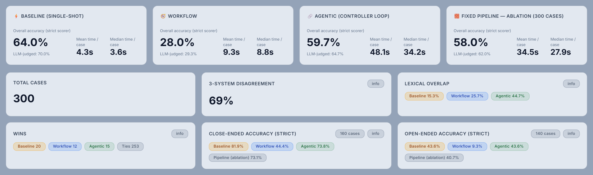
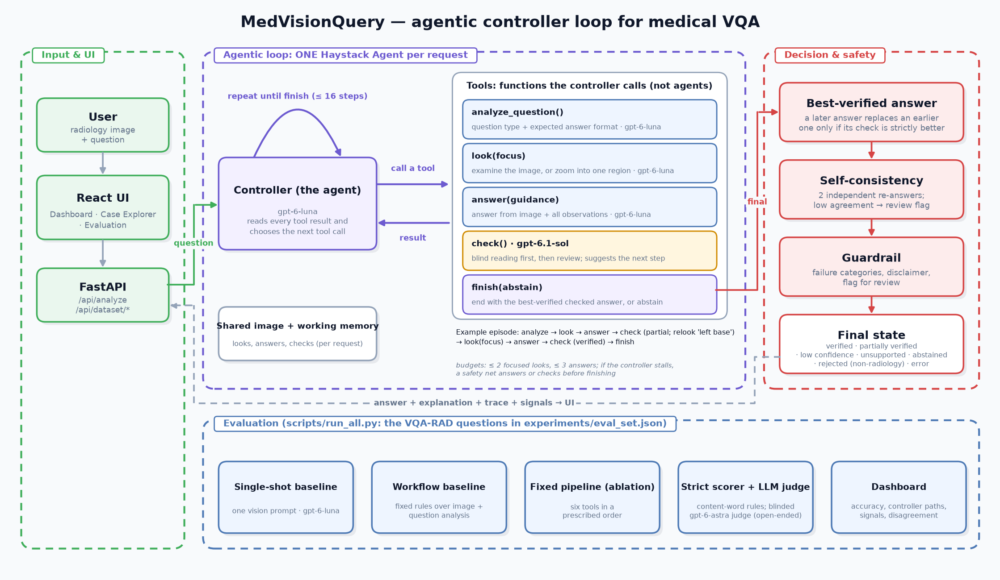
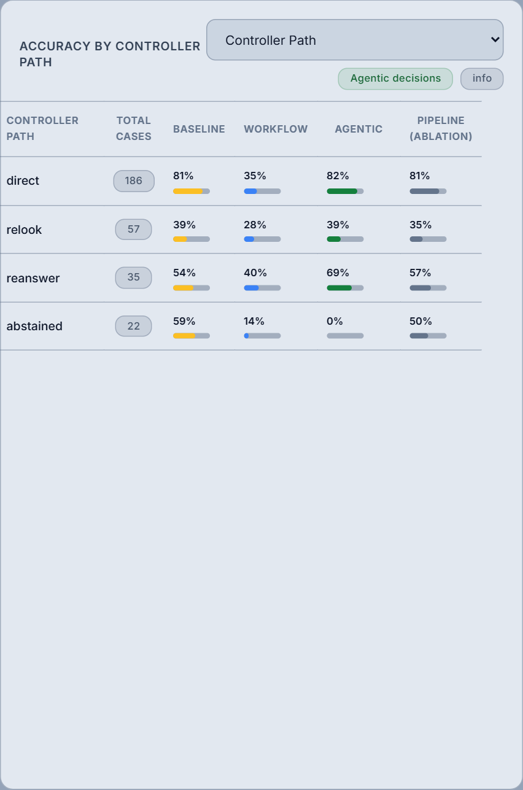

# MedVisionQuery — an agentic multimodal system for medical visual question answering

MedVisionQuery answers natural-language questions about radiology images (X-ray, CT, MRI). Its agentic system is a
**Haystack Agent controller** that decides, case by case, how to look at the image, answer, check the answer *against
the image*, and whether to re-examine a region, revise, abstain or finish. It is evaluated against a single-prompt
baseline, a hand-designed workflow and a fixed-pipeline ablation on 300 VQA-RAD questions.

> ⚠️ **For education and research only. Not for clinical use.**

Built for SUTD 51.511 Multimodal Generative AI (Template 1: Agentic Multimodal System). Report:
[`docs/report/MGAI_Final_Report_Group9_revised.pdf`](docs/report/MGAI_Final_Report_Group9_revised.pdf)
(LaTeX source in `docs/report/`; build with `tectonic main.tex`).

---

## Contents

- [Results at a glance](#results-at-a-glance)
- [Problem and task decomposition](#problem-and-task-decomposition)
- [Agent architecture](#agent-architecture)
- [Multimodal grounding](#multimodal-grounding)
- [Control and failure handling](#control-and-failure-handling)
- [Evaluation design](#evaluation-design)
- [Results](#results)
- [Failure analysis](#failure-analysis)
- [Reflection and limitations](#reflection-and-limitations)
- [User interface](#user-interface)
- [Quick start](#quick-start)
- [Reproducing the evaluation](#reproducing-the-evaluation)
- [Project structure](#project-structure)
- [API reference](#api-reference)

---

## Results at a glance

<!-- generated:glance -->
Run `2026-10-15_1641`: a seeded, stratified sample of 300 VQA-RAD questions (160 close-ended, 140 open-ended), all systems on the same answering model
(`gpt-6-luna`; the agentic loop and the fixed pipeline also use `gpt-6.1-sol` as verifier). Per-case times were
measured with four cases running at once; the mean is pulled up by the 63 re-look-path episodes, which take longest (actual run times are in
[Run timings](#run-timings)). "Strict" uses the rule-based scorer; "judged" scores open-ended answers with a blinded LLM
judge, `gpt-6-astra` (see [Evaluation design](#evaluation-design)).

| System | Strict accuracy | Judged accuracy | Time / case (mean · median) | Cost / case |
|---|---|---|---|---|
| Single-shot baseline | 64.0% | 70.0% | 4.3 s · 3.6 s | $0.0002 |
| Workflow baseline (hand-designed) | 28.0% | 29.3% | 9.3 s · 8.8 s | $0.0005 |
| **Agentic controller loop** | 59.7% | 64.7% | 48.1 s · 34.2 s | $0.0132 |
| Fixed pipeline (ablation) | 58.0% | 62.0% | 34.5 s · 27.9 s | $0.0068 |

- **Agentic vs single-shot: single-shot ahead, significant on the judged score only** (-4.3 points strict, p = 0.079; -5.3 judged, p = 0.033; exact McNemar).
- **Agentic vs fixed pipeline:** +1.7 points strict (p = 0.58), +2.7 judged (p = 0.35).
- **Agentic vs its verifier model alone** (`gpt-6.1-sol` answering once, the check's blind reading): 59.7% vs 67.0% strict (p = 0.008).
- **Confidence and stability:** answers the check verified are 71% correct, the loop's
  other answers 40% (abstentions excluded); between two runs, 12% of the loop's answers change right ↔ wrong vs
  6% for the single prompt.
<!-- /generated:glance -->



---

## Problem and task decomposition

**Input:** a radiology image (JPEG/PNG) and a free-text question. **Output:** an answer, an explanation grounded in
visible evidence, a verification status, uncertainty signals, and a trace of every decision.

A single model call conflates steps that fail in different ways. The system separates them:

| Sub-task | Question it answers | Component |
|---|---|---|
| Question understanding | What kind of answer is expected (yes/no, location, modality…)? | `analyze_question` |
| Perception | What does the image show *that bears on this question*? | `look(focus)` |
| Synthesis | What is the best answer given the image and observations? | `answer(guidance)` |
| Verification | Does the image itself support this answer? What should happen next? | `check` |
| Planning / control | Re-examine a region, revise, abstain or finish? | Controller (Haystack Agent) |

---

## Agent architecture



### Controller loop

A fresh Haystack `Agent` is created per request (`backend/agents/agentic_loop.py`). Its tools are bound to a
per-request working memory that holds the image, the question analysis, every look, every answer and every check.
The controller sees only short text results from each tool and chooses the next call. There is one agent (the
controller); the five tools are functions it calls, not agents. `check` only *recommends* the next step and the
controller decides whether to follow it; in the fixed-pipeline ablation every step runs in a prescribed order.

| Tool | Role | Model (default) | Notes |
|---|---|---|---|
| `analyze_question()` | Task understanding | gpt-6-luna | Question type and expected answer format; keyword rules use whole-word matching |
| `look(focus)` | Perception (executor) | gpt-6-luna, vision | Looks *with the question in mind*; with `focus` it **zooms**: the named region is located, cropped and enlarged, and examined next to the full image (if it cannot be located, a plain re-look). The first look also rejects non-radiology images |
| `answer(guidance)` | Synthesis (executor) | gpt-6-luna, vision | Receives the image plus all observations; `guidance` carries what the verifier asked to fix |
| `check()` | Evaluator (a higher-tier model) | gpt-6.1-sol, vision | Two parts, in this order. **Blind reading** (independent): once per episode, the verifier answers from the image and question alone, without the proposed answer or the looker's notes. **Review** (critic): it checks the answer against the image (grounding, contradictions, format) and returns a status, the issues found and a next step (`accept`, `relook` with a focus, `reanswer` with guidance, `abstain`); the guidance may include a suggested corrected answer. An answer is *verified* only if the verifier returns `verified`, no format or question-type check fails, **and** the blind reading agrees (word rules first, exact for yes/no; for open-ended answers the verifier judges whether the two mean the same). The controller learns only whether they agree, never the blind answer, though the review's guidance may still name a corrected answer |
| `finish(abstain)` | Decision | — | Ends the episode; a normal finish is refused while the latest answer is unchecked (abstaining is not) |

Budgets: at most 2 focused re-looks, 3 answers and 16 agent steps. If the controller stalls, a safety net answers
and/or checks before finishing. Paths observed in the current run:

<!-- generated:paths -->
| Path | Cases | Tool sequence |
|---|---|---|
| direct | 187 | analyze → look → answer → check → finish |
| relook | 63 | … → check → look(focus) → answer(guided) → check → finish |
| reanswer | 25 | … → check → answer(guided) → check → finish |
| abstained | 25 | … → check → finish(abstain) |
<!-- /generated:paths -->

### Why these models and tools

- **Haystack `Agent` + `Tool`** gives a tool-calling loop with typed tools and exit conditions. Keeping the image in
  per-request memory (not in the controller's context) keeps the controller cheap.
- **One model family (OpenAI), roles sized by need.** The controller and question analysis are simple decisions, so
  they use `gpt-6-luna` with low or no reasoning effort. Answering uses `gpt-6-luna` with medium effort, and the answerer always sees
  the image: a text description of the image loses the visual detail many questions depend on.
- **A different, higher-tier model verifies; a third judges.** `check` uses `gpt-6.1-sol` (20× `gpt-6-luna`'s
  per-token price), so the answering model never verifies itself and the critique comes from a higher-tier model. Because the review's guidance can suggest a
  corrected answer, part of the loop's accuracy can come from the verifier, so every run also scores the verifier
  answering alone (its blind reading) as a reference. The evaluation judge, `gpt-6-astra`, takes part in no system.
- All roles are configurable (`MODEL_<ROLE>`, `REASONING_EFFORT_<ROLE>` in `.env`); every call's tokens and cost are
  recorded.

### Baselines and ablation

| System | File | What it does |
|---|---|---|
| Single-shot baseline | `backend/agents/baseline.py` | One vision prompt; asked for a concise answer that starts with yes/no where applicable |
| Workflow baseline | `backend/agents/workflow_baseline.py` | Fixed chain: question-agnostic image description → question analysis → hand-written rules per question type |
| Fixed pipeline (ablation) | `backend/agents/orchestrator.py` | A controller instructed to call six tools in a prescribed order (`interpret_image` → `analyze_question` → `filter_image_context` → `route_difficulty` → `reason_answer` → `verify_answer`), re-running the sequence once when verification flags a fixable or high-severity problem. Same models, but a question-agnostic image description, no zoom, no blind check and a text-only verifier, so the comparison measures the agentic design as a whole (control, question-aware and zoomed looks, image-grounded checking), not control alone |

---

## Multimodal grounding

The two modalities are the image and the text question. They interact at every step that matters:

| Step | Image | Text |
|---|---|---|
| `analyze_question()` | ✗ | the question, plus any observations so far |
| `look(focus)` | ✓ sent at high detail, plus an enlarged crop of the focus region | the question (and focus) decide what is examined |
| `answer(guidance)` | ✓ sent directly | question analysis, all observations, verifier guidance |
| `check()` | ✓ sent directly (blind reading: image + question only) | answer, explanation, observations (review step only) |
| Controller | ✗ | short tool results only |

In the agentic loop, every model that looks, answers or verifies sees the image itself, because a text description
of the image loses the visual detail many questions depend on; only the question analysis and the controller work from
text. The evaluation's LLM judge compares answers with the reference as text and does not see the image.

---

## Control and failure handling

| Mechanism | What it does |
|---|---|
| Image-grounded verification | `check` takes an independent blind reading of the image (once per episode), judges the answer against the image, and compares the two: 5 checks, a status (`verified`, `partially_verified`, `low_confidence`, `unsupported`) and a recommended next action |
| Targeted recovery | The controller zooms into a region (`look(focus)`) or revises (`answer(guidance)`) instead of re-running everything |
| Best-verified answer | A later answer replaces an earlier one only if its check is strictly better (re-looks can over-read) |
| Self-consistency | After finishing, the answerer is re-asked independently (2×); low agreement adds `self_inconsistent` and flags the case for review |
| Abstention | The controller may abstain; abstentions are reported as such (never normalised into "no") |
| Guardrail | Failure categories (`unsupported_claim`, `low_confidence`, `visual_contradiction`, `partially_verified`, `question_answer_mismatch`, `reasoning_generation_unstable`, `parser_failure`, `self_inconsistent`), a disclaimer and a review flag |
| Input rejection | Non-radiology images are rejected on the first look. Unreadable images fall back to the raw bytes; if the first look still fails, the system stops instead of answering blind |

---

## Evaluation design

Every evaluation is a **run** with its own folder, `experiments/runs/<run_id>/` (cases, judge verdicts, variance
repeats, metrics, timings, cost); a later run never changes an earlier one, and `experiments/runs/README.md` lists
them all. Every result in this README and the report (accuracies, tests, counts, timings, costs) comes from the current
(latest completed) run. Text between `<!-- generated -->` markers and the report's numbers are written by
`scripts/final_metrics.py` and `scripts/update_docs.py` and are not edited by hand; the few counts quoted in the
narrative (failure patterns, reflection) were computed from the same run's case files. Settings such as thresholds and
budgets come from the code.

- **Data:** VQA-RAD has 2,244 questions, all with a reference answer. Excluding one known-bad item and the 300
  test-split questions of an earlier evaluation run leaves 1,943, from which 300 are drawn at random (seed 51511),
  keeping the pool's mix of close-ended (yes/no, or a single binary term such as normal/abnormal) and open-ended
  questions (160 close-ended, 140 open-ended). No system is trained, so the train/test labels play no role; because the
  excluded questions were all test-split, 277 of the 300 carry the train label. The list is `experiments/eval_set.json`
  (`python scripts/make_eval_set.py --size 300 --split all --seed 51511 --exclude-run 2026-10-15_1308`); per-type
  numbers for small categories are noisy.
- **Systems:** single-shot baseline, workflow baseline, agentic loop and fixed-pipeline ablation, all on the same cases
  and the same answering model.
- **Strict scorer** (`backend/utils/scoring.py`):
  - yes/no ground truth: the answer must start with the correct word;
  - binary terms (normal/abnormal, present/absent, …): the correct term and not its opposite;
  - counting: the numbers must match;
  - open-ended: every content word of the ground truth must appear (aliases such as CT = computed tomography; plurals
    folded), or at least 60% of them for ground truths longer than 3 words. Left/right conflicts, and answers starting
    with "no" when the ground truth does not, are wrong. S-PubMedBert-MS-MARCO similarity is only a strict fallback
    (≥ 0.95 short, ≥ 0.90 long).
- **LLM judge** (`scripts/judge_open_ended.py`): `gpt-6-astra` judges **every** open-ended answer of every system,
  right or wrong by the strict rules, for meaning equivalence with the ground truth, blinded to the system (answers
  shuffled and anonymised). Its verdict is the "judged" score for open-ended answers; close-ended answers stay rule-based.
  Astra neither answers (`gpt-6-luna`) nor verifies (`gpt-6.1-sol`) in any system. A 30-verdict
  spot check agreed with 29 credit decisions; in the other (#22) the judge was too harsh on an agentic-loop answer
  (`judge_review_sample.md` in the run folder; AI-assisted review, not human annotation).
- **Statistics:** 95% intervals are about ±5.6 points at n = 300 (±5.7 at most); paired comparisons use the exact
  McNemar test.
- **Variance:** the baseline and agentic loop are run again on 100 of the evaluated questions.
- **Code changes after the run** (the run is recorded at commit `2b1d54f`): the yes/no normaliser now checks negated
  phrases before positive words ("no visible fracture" was read as "yes"), and `check` takes the blind reading before
  the review, as the controller's prompt states. Neither changes this run's results: replaying all 4,519 recorded
  answers through the old and new normaliser gives identical output, and the two `check` calls are independent (neither
  sees the other's output), so no model input changes.
<!-- generated:cost -->
- **Cost:** every OpenAI call is recorded (`backend/utils/usage.py`): evaluation $6.20, repeats
  $1.31, judge $1.22 ($8.73 in total).

### Run timings

Wall-clock time of each stage of run `2026-10-15_1641`, recorded by `scripts/run_all.py`
(`experiments/runs/2026-10-15_1641/run.json`):

| Stage | Started | Finished | Wall clock | Work | Cost |
|---|---|---|---|---|---|
| Main evaluation (4 systems) | 2026-10-15 16:41:12 | 17:48:42 | 67 min 29 s | 300 cases x 4 systems, 4 at a time | $6.20 |
| LLM judge (`gpt-6-astra`) | 2026-10-15 17:48:43 | 17:59:33 | 10 min 50 s | 140 open-ended cases | $1.22 |
| Variance repeats (baseline + agentic) | 2026-10-15 17:59:33 | 19:22:22 | 82 min 48 s | 100 cases, one at a time | $1.31 |

Per-case times in the results tables are each system's own latency inside a case; a full case (all four systems in
parallel) took 52.9 s on average.
<!-- /generated:cost -->

---

## Results

<!-- generated:results -->
### Overall

| System | Strict | Judged | Close-ended (160) | Open-ended (140), strict → judged |
|---|---|---|---|---|
| Single-shot baseline | 64.0% | 70.0% | 81.9% | 43.6% → 56.4% |
| Workflow baseline | 28.0% | 29.3% | 44.4% | 9.3% → 12.1% |
| **Agentic loop** | 59.7% | 64.7% | 73.8% | 43.6% → 54.3% |
| Fixed pipeline (ablation) | 58.0% | 62.0% | 73.1% | 40.7% → 49.3% |

Paired comparisons (cases where exactly one of the two systems is right):

| Comparison | Strict | Judged |
|---|---|---|
| Agentic vs single-shot | 17 vs 30, p = 0.079 | 17 vs 33, p = 0.033 |
| Agentic vs fixed pipeline | 28 vs 23, p = 0.58 | 32 vs 24, p = 0.35 |

### By controller path

| Path | Cases | Agentic | Single-shot | Fixed pipeline |
|---|---|---|---|---|
| direct | 187 | 75% | 74% | 70% |
| relook | 63 | 38% | 41% | 33% |
| reanswer | 25 | 56% | 64% | 52% |
| abstained | 25 | — (abstained) | 44% | 40% |



### Uncertainty signals predict errors

| Signal | Levels | Agentic accuracy |
|---|---|---|
| Verification (answered questions) | verified (220) / not verified (55) | 71% / 40% |
| Self-consistency | high (242) / medium or low (33) | 69% / 39–40% |
| Abstention | 25 cases, on which the single-shot baseline is wrong 56% of the time | — |

### Stability across runs (same 100 cases)

| System | Run 1 | Run 2 | Answers that flipped right ↔ wrong |
|---|---|---|---|
| Single-shot baseline | 60/100 | 60/100 | 6 (6%) |
| Agentic loop | 59/100 | 55/100 | 12 (12%) |

### What the loop's mechanisms did

| Mechanism | Result in this run |
|---|---|
| Revision (re-look or re-answer) | 88 questions: 11 wrong first answers fixed, 6 right ones broken (first and final answers both scored strictly) |
| Blind check | Objected to 82 first answers; 59 of them (72%) were wrong. Where the word rules could not settle agreement, the verifier's meaning comparison decided it (66 answers) |
| Zoom | A zoomed look in 63 episodes (5 later abstained); on the 58 answered, agentic 36.2% vs single-shot 39.7% |
| Abstention | 25 questions; the loop's own last answer was right in 7, the single prompt in 11 |
| Answered questions only | Agentic 65.1% vs single-shot 65.8% on the same 275 questions |

The blind reading is the verifier model (`gpt-6.1-sol`) answering from the image alone. Scored on its own it reaches
67.0% strict (agentic vs blind reading 21 vs 43, p = 0.008; blind reading vs single-shot
29 vs 20, p = 0.25).
<!-- /generated:results -->

---

## Failure analysis

The four analyses Template 1 asks for are computed for every run and summarised on the dashboard.

<!-- generated:failure -->
- **Self-consistency checks:** 2 independent re-answers per case; low agreement flags the case for review. Low
  consistency marks uncertainty, not certain error: 39% of low-consistency answers were still correct.
- **Cross-modal agreement:** the verifier sees the image, so "explanation grounded in evidence" and "no
  contradictions" are checked against the image itself, not only a text description.
- **Verifier model:** a different, higher-tier model (`gpt-6.1-sol`) verifies `gpt-6-luna`'s answers; after its
  checks, 113 of 300 episodes leave the direct path.
- **Disagreement analysis:** the three systems disagree on 69% of cases under the same matching rules;
  wins (only one system right): agentic 15, single-shot 20, workflow 12.

Representative cases, chosen automatically by `scripts/final_metrics.py` (screenshots in `eval-dashboard-screenshots/`):

| Case | What happened |
|---|---|
| 503 "is there a pleural effusion present?" | A focused re-look got it right; the single prompt did not (agentic: "no"; single prompt: "Yes, there is a small left pleural effu…"; reference: "no") |
| 457 "what brain region demonstrates edema?" | A re-answer guided by the verifier got it right; the single prompt was wrong (agentic: "Bilateral basal ganglia"; single prompt: "Both thalami demonstrate edema."; reference: "basal ganglia") |
| 8 "where is the mass?" | An intermediate answer was right, but a later revision replaced it with a wrong one that the check verified; the single prompt was right (agentic: "Around the posterior third ventricle, e…"; single prompt: "The mass is in the midline pineal regio…"; reference: "pineal region") |
| 19 "what plane is seen?" | Low self-consistency flagged the case for review, though the final answer was right (agentic: "Frontal (PA) view"; single prompt: "Frontal (coronal) plane."; reference: "pa") |
<!-- /generated:failure -->

**Systematic failure patterns**

1. **Shared perception blind spot:** 65 questions (22%) defeat the single prompt, the loop and the fixed pipeline
   alike under the judge, 49 of them open-ended (mostly asking for a specific location, finding or diagnosis). When the looker and the verifier
   misread the image the same way, no check catches it (the verifier's blind reading was right on only 16 of the 65,
   and even then it did not carry through), and self-consistency rarely helps: 51 of the 59 the loop answered
   still get high consistency, so the models are consistently wrong rather than unsure.
2. **Abstention withholds right answers:** the loop abstained on 25 questions, 16 of them close-ended. In 21 the
   verifier's review recommended abstaining, 14 times although its own blind reading agreed with the loop's best-verified
   answer. The single prompt was right on 11 of the 25, the loop's own last answer on 7 and the blind reading on 18.
   This is where the loop loses: on the 275 questions it answered the two are level (65.1% vs 65.8%), and the
   abstentions account for 11 of the single prompt's 13-question strict lead.
3. **The hardest questions resist re-looking:** zoomed re-looks concentrate on the hardest questions and do not lift
   them above the single prompt, and re-answered questions also trail it; revisions broke 6 right first answers
   (against 11 fixed), which keeping the best-verified answer limits but does not prevent.
4. **Benchmark quirks:** some questions are ungrammatical ("is the gyral enhancement?") or expect detail an image
   rarely settles ("below the 7th rib in the right lung"), yet the dataset gives a reference answer, so abstaining
   or hedging on them is scored wrong.
5. **Workflow rigidity:** fixed rules answer "Abdomen" or "Chest" where a specific finding or side is needed.

---

## Reflection and limitations

**When is agentic behaviour beneficial?** In this run, not for accuracy. The single prompt is more accurate than
the agentic loop (significantly so under the judge, not on the strict score), and the loop's higher-tier verifier,
answering alone, is significantly more accurate than the loop. The loss comes almost entirely from abstention: on
the 275 questions it answers, the loop matches the single prompt (65.1% vs 65.8%), but its 25 abstentions score zero
on the strict scorer. Revision fixes slightly more answers than it breaks (11 vs 6, not significant), partly by
adopting answers the verifier's guidance suggested, and when the blind check objects, the first answer is usually
wrong (59 of 82). The controller does not use that signal where it matters most: it abstains where the blind reading
is usually right (18 of the 25 abstentions); where it answers against the blind reading, the two are right about
equally often (15 vs 17 of 43). A post-hoc check (rule chosen after seeing these results, so not a system result)
shows the scale: taking the blind reading whenever the loop abstained or disagreed with it would have raised the loop
from 59.7% to 66.3% strict, close to the verifier's own 67.0%, almost all of it from the abstentions, so the loop
would then be little more than its verifier. Its answers also flipped between runs more often (12 vs 6 of 100; not
significant, Fisher p = 0.22). What it adds is *calibrated confidence*: answers it verifies are 71% correct against 40% for its other
answers, so "verified" is a usable signal for deciding which answers need review, and every decision is auditable. That costs about 58 times as much as a single prompt. The next step this
run points to is answering instead of abstaining, with a low-confidence flag (for example with the blind reading,
right on 18 of the 25 abstentions), tested on fresh questions.

**Limitations**

<!-- generated:limit-cost -->
- About 58× the cost and 10× the (median) latency of a single prompt.
<!-- /generated:limit-cost -->
- The verifier shares the perception weaknesses of vision models; agreement is not correctness (in case 8 the check
  verified a wrong revision that had replaced a right answer).
- The loop's accuracy cannot be fully separated from its verifier's, because the verifier's guidance may suggest
  answers. A critique-only verifier (issues, no suggested answer) would isolate the loop's own contribution.
- Abstentions are scored as wrong (under the judge, one is credited because its reference answer is "maybe"), so
  the abstention policy lowers accuracy by design.
- The loop's answers flipped between runs more often than a single prompt's (12 vs 6 of 100), though not
  significantly.
- 300 questions give intervals of at most ±5.7 points; per-type results for small categories are noisy.
- The sample comes from the whole dataset, mostly train-labelled questions, so scores are not directly comparable
  with published VQA-RAD results on its test split.
- The strict scorer under-credits paraphrases and over-credits vague answers that contain the reference word; the
  LLM judge corrects both, but it is a model, spot-checked rather than human-annotated.
- The workflow baseline uses a question-agnostic image description by design.
- The system uses no retrieval, so it cannot draw on knowledge that is not visible in the image.

---

## User interface

- **Dashboard:** upload an image, ask a question, and compare the agentic loop with both baselines. The agentic view
  shows the answer, explanation, verification checks, failure categories and the full trace.
- **Case Explorer:** browse the evaluation questions with the single prompt's, the workflow's and the loop's cached
  answers and the loop's full trace (the fixed pipeline's answers are in the Evaluation table);
  search by question text or ID (an exact ID match is listed first). A question not in the current run runs live.
- **Evaluation:** strict and LLM-judged accuracy for all four systems, close- and open-ended accuracy, accuracy by
  question type and by controller path, disagreement, and a filterable table of every case.

---

## Quick start

**Prerequisites:** Python 3.12, Node.js 20.19+ or 22.12+ (required by Vite 8), and an OpenAI API key with access to
the models in `.env`.

```bash
git clone https://github.com/clarence-ck/med-vqa-rad-agentic.git
cd med-vqa-rad-agentic
cp .env.example .env            # set OPENAI_API_KEY; per-role models are documented in the file

conda env create -f environment.yml   # recommended (native deps on Windows)
conda activate medvisionquery
# or: pip install -r backend/requirements.txt

python scripts/download_dataset.py    # VQA-RAD → data/vqa-rad/

cd backend && uvicorn main:app --port 8000      # terminal 1
cd frontend && npm install && npm run dev       # terminal 2
```

<!-- generated:question-cost -->
Open http://localhost:5173. Each new question runs all three systems and costs about $0.014 with the default models.
<!-- /generated:question-cost -->

Run the tests from `backend/`: `python -m unittest discover tests` (no API calls). To rebuild every result file,
figure, screenshot and the report from the cached results without spending anything:
`python scripts/run_all.py --stages metrics,docs,diagram,screenshots,report`.

---

## Reproducing the evaluation

<!-- generated:reproduce -->
```bash
python scripts/run_all.py --dry-run         # show the stages and the estimated cost; spends nothing
python scripts/run_all.py                   # everything: evaluation, repeats, judge, metrics, docs, figures, report
python scripts/run_all.py --stages metrics,docs,diagram,report   # rebuild outputs from cached results (free)
```

| Stage | What it runs | Last cost | Last wall clock |
|---|---|---|---|
| `eval` | `run_case_explorer_cache.py --ablation --concurrency 4` (300 questions × 4 systems) | $6.20 | ~67 min |
| `variance` | `repeat_cases.py --from-eval-sample 300 --n 100` (baseline + agentic loop again) | $1.31 | ~83 min |
| `judge` | `judge_open_ended.py` | $1.22 | ~11 min |
| `metrics` | `final_metrics.py` → `final_metrics.json` and `cases.csv` in the run folder | free | seconds |
| `docs` | `update_docs.py` → README blocks and `docs/report/results.tex` | free | seconds |
| `diagram` | `system_diagram.py` → `docs/report/system_diagram.png` (README and report) | free | seconds |
| `screenshots` | starts backend + frontend, `capture-screenshots.mjs` for the showcase cases | free | ~1 min |
| `report` | `tectonic main.tex` → `docs/report/MGAI_Final_Report_Group9_revised.pdf` | free | ~1 min |
<!-- /generated:reproduce -->

- Paid stages ask for confirmation (or `--yes`) and share one spend cap per run, `--budget` (default $10). The judge
  runs before the variance repeats, so if money runs short only the repeats are cut.
- An interrupted run (crash, closed laptop, budget reached) continues with `python scripts/run_all.py --resume`:
  finished cases are kept, and the README and report are only rebuilt once the run is complete.
- `screenshots` needs Node.js and a local Chrome or Edge; `report` needs `tectonic` (included in `environment.yml`).
- Two things stay manual after a full re-run: re-checking the judge spot check
  (`judge_review_sample.md` in the run folder) and re-reading the narrative in *Systematic failure patterns* and the
  report.
- Every cached result records the git commit, models, reasoning efforts and token usage. Failed API calls are never
  cached; the runner retries them and counts their cost toward the cap.

---

## Project structure

```text
backend/
  main.py                      FastAPI app
  config.py                    per-role models and reasoning effort, AGENT_MODE, timeouts, code version
  agents/
    agentic_loop.py            controller loop (the agentic system)
    look_agent.py              question-aware perception, focused re-looks, radiology check
    question_analyzer.py       question type and expected answer format
    reasoning_agent.py         answer synthesis (image + observations + guidance)
    verification_agent.py      image-grounded verification and next-action recommendation
    orchestrator.py            fixed six-stage pipeline (ablation)
    image_interpreter.py       question-agnostic description (workflow baseline, ablation)
    difficulty_router.py       difficulty routing (ablation only)
    baseline.py                single-shot baseline
    workflow_baseline.py       hand-designed workflow baseline
  logger.py                    session log (backend/logs/), lines tagged with the case being run
  routes/                      /api/analyze*, /api/dataset/* (samples, analysis, evaluation)
  utils/                       scoring, answer normalisation, image zoom, usage tracking, data loading
  utils/runs.py                where evaluation runs live; which run is current
  tests/                       unit tests (no API calls)
frontend/                      React 19 + Vite UI; scripts/capture-screenshots.mjs
scripts/                       run_all.py (one command for everything) and the stages it runs
experiments/runs/              one folder per evaluation run (cases/, judgments, variance, metrics, cases.csv)
experiments/eval_set.json      the evaluation questions (scripts/make_eval_set.py)
eval-dashboard-screenshots/    dashboard screenshots (regenerated by scripts/run_all.py)
```

---

## API reference

| Method | Path | Description |
|---|---|---|
| GET | `/` | Health check and endpoint list |
| POST | `/api/analyze` | Agentic system (`AGENT_MODE=loop` by default, `pipeline` for the ablation); multipart `image`, `question` |
| POST | `/api/analyze/baseline` | Single-shot baseline |
| POST | `/api/analyze/workflow` | Workflow baseline |
| GET | `/api/dataset/samples` | The evaluation questions (`experiments/eval_set.json`) |
| GET | `/api/dataset/sample/{id}` | One case with its image |
| GET | `/api/dataset/sample/{id}/analysis?refresh=&ablation=` | Run (or load cached) all systems on a case |
| GET | `/api/dataset/evaluation?run=` | Aggregate metrics and per-case rows of a run (default: the current run) |
