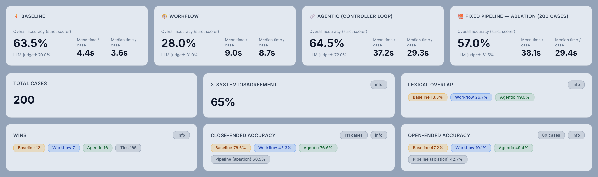
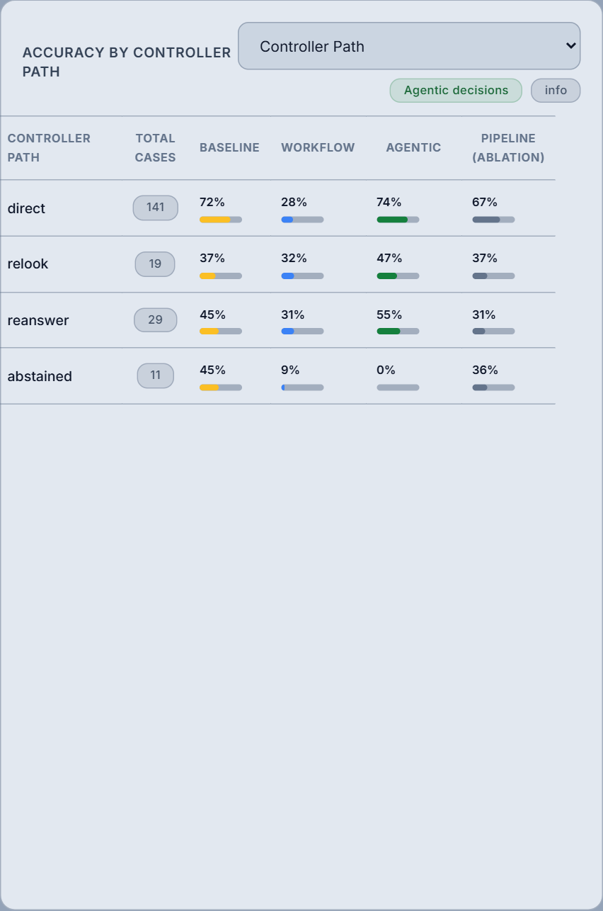

# MedVisionQuery — an agentic multimodal system for medical visual question answering

MedVisionQuery answers natural-language questions about radiology images (X-ray, CT, MRI). Its agentic system is a
**Haystack Agent controller** that decides, case by case, how to look at the image, answer, check the answer *against
the image*, and whether to re-examine a region, revise, abstain or finish. It is evaluated against a single-prompt
baseline, a hand-designed workflow and a fixed-pipeline ablation on 200 random VQA-RAD test questions.

> ⚠️ **For education and research only. Not for clinical use.**

Built for SUTD 51.511 Multimodal Generative AI (Template 1: Agentic Multimodal System). Report:
[`docs/report/MGAI_Final_Report_Group9_revised.pdf`](docs/report/MGAI_Final_Report_Group9_revised.pdf)
(LaTeX source in `docs/report/`; build with `tectonic main.tex`).

---

## Contents

- [Results at a glance](#results-at-a-glance)
- [Problem and task decomposition](#problem-and-task-decomposition)
- [Agent architecture](#agent-architecture)
- [Multimodal grounding](#multimodal-grounding)
- [Control and failure handling](#control-and-failure-handling)
- [Evaluation design](#evaluation-design)
- [Results](#results)
- [Failure analysis](#failure-analysis)
- [Reflection and limitations](#reflection-and-limitations)
- [What changed since the April 2026 version](#what-changed-since-the-april-2026-version)
- [User interface](#user-interface)
- [Quick start](#quick-start)
- [Reproducing the evaluation](#reproducing-the-evaluation)
- [Project structure](#project-structure)
- [API reference](#api-reference)

---

## Results at a glance

200 seeded-random VQA-RAD test questions (111 close-ended, 89 open-ended), all systems on the same model
(`gpt-6-luna`), 0 API failures. Per-case times were measured with four cases running at once; the mean is pulled up
by a few long re-look cases (actual run times are in [Run timings](#run-timings)). "Strict" uses the rule-based scorer; "judged" also accepts open-ended paraphrases
confirmed by a blinded LLM judge (see [Evaluation design](#evaluation-design)).

| System | Strict accuracy | Judged accuracy | Time / case (mean · median) | Cost / case |
|---|---|---|---|---|
| Single-shot baseline | 63.5% | 70.0% | 4.4 s · 3.6 s | $0.0002 |
| Workflow baseline (hand-designed) | 28.0% | 31.0% | 9.0 s · 8.7 s | $0.0005 |
| **Agentic controller loop** | **64.5%** | **72.0%** | 37.2 s · 29.3 s | $0.0094 |
| Fixed pipeline (ablation) | 57.0% | 61.5% | 38.1 s · 29.4 s | $0.0070 |

- **Agentic vs single-shot: a tie** (exact McNemar p = 0.86 strict, 0.61 judged).
- **Agentic vs fixed pipeline: the controller's decisions help** (+7.5 points strict, p = 0.02; +10.5 judged, p = 0.002).
- **The agentic system's value is reliability, not raw accuracy:** its verification and self-consistency signals
  predict errors, it abstains on hard cases, and it is far more stable across re-runs (2% of answers flip vs 12% for
  the single prompt).



---

## Problem and task decomposition

**Input:** a radiology image (JPEG/PNG) and a free-text question. **Output:** an answer, an explanation grounded in
visible evidence, a verification status, uncertainty signals, and a trace of every decision.

A single model call conflates steps that fail in different ways. The system separates them:

| Sub-task | Question it answers | Component |
|---|---|---|
| Question understanding | What kind of answer is expected (yes/no, location, modality…)? | `analyze_question` |
| Perception | What does the image show *that bears on this question*? | `look(focus)` |
| Synthesis | What is the best answer given the image and observations? | `answer(guidance)` |
| Verification | Does the image itself support this answer? What should happen next? | `check` |
| Planning / control | Re-examine a region, revise, abstain or finish? | Controller (Haystack Agent) |

---

## Agent architecture


### Controller loop

A fresh Haystack `Agent` is created per request (`backend/agents/agentic_loop.py`). Its tools are bound to a
per-request working memory that holds the image, the question analysis, every look, every answer and every check.
The controller sees only short text results from each tool and chooses the next call:

| Tool | Role | Model (default) | Notes |
|---|---|---|---|
| `analyze_question()` | Task understanding | gpt-6-luna | Question type and expected answer format; keyword rules use whole-word matching |
| `look(focus)` | Perception (executor) | gpt-6-luna, vision | Looks *with the question in mind*; with `focus`, re-examines a named region. The first look also rejects non-radiology images |
| `answer(guidance)` | Synthesis (executor) | gpt-6-luna, vision | Receives the image plus all observations; `guidance` carries what the verifier asked to fix |
| `check()` | Evaluator | gpt-6.1-sol, vision | Verifies against the image and recommends `accept`, `relook` (with a focus), `reanswer` (with guidance) or `abstain` |
| `finish(abstain)` | Decision | — | Ends the episode; refused while the latest answer is unchecked |

Budgets: at most 2 focused re-looks, 3 answers and 16 agent steps. If the controller stalls, a safety net answers
and/or checks before finishing. Paths observed on the 200-case evaluation:

| Path | Cases | Tool sequence |
|---|---|---|
| direct | 141 | analyze → look → answer → check → finish |
| relook | 19 | … → check → look(focus) → answer(guided) → check → finish |
| reanswer | 29 | … → check → answer(guided) → check → finish |
| abstained | 11 | … → check → finish(abstain) |

### Why these models and tools

- **Haystack `Agent` + `Tool`** gives a tool-calling loop with typed tools and exit conditions. Keeping the image in
  per-request memory (not in the controller's context) keeps the controller cheap.
- **One model family (OpenAI), roles sized by need.** The controller and question analysis are simple decisions, so
  they use `gpt-6-luna` with low or no reasoning effort. Answering uses `gpt-6-luna` with medium effort: a 20-case
  pilot showed that giving the answerer the image mattered far more than model size (50% → 70%).
- **A different model verifies.** `check` (and the evaluation judge) use `gpt-6.1-sol`, so the model that answered
  does not verify its own answer.
- All roles are configurable (`MODEL_<ROLE>`, `REASONING_EFFORT_<ROLE>` in `.env`); every call's tokens and cost are
  recorded.

### Baselines and ablation

| System | File | What it does |
|---|---|---|
| Single-shot baseline | `backend/agents/baseline.py` | One vision prompt; asked for a concise answer that starts with yes/no where applicable |
| Workflow baseline | `backend/agents/workflow_baseline.py` | Fixed chain: question-agnostic image description → question analysis → hand-written rules per question type |
| Fixed pipeline (ablation) | `backend/agents/orchestrator.py` | The original six stages (interpret → analyze → filter → route → reason → verify, with retry) in a fixed order, with the reasoner given the image; isolates what the controller's decisions add |

---

## Multimodal grounding

The two modalities are the image and the text question. They interact at every step that matters:

| Step | Image | Text |
|---|---|---|
| `look(focus)` | ✓ sent at high detail | the question (and focus) decide what is examined |
| `answer(guidance)` | ✓ sent directly | question analysis, all observations, verifier guidance |
| `check()` | ✓ sent directly | answer, explanation, observations |
| Controller | ✗ | short tool results only |

The April version described the image once, *without the question*, and every later stage worked from that text. A
20-case pilot showed this was the main cause of errors: all four failures of the text-only reasoner were "cannot be
determined from the image description"; with the image, all four were answered correctly.

---

## Control and failure handling

| Mechanism | What it does |
|---|---|
| Image-grounded verification | `check` judges the answer against the image: 5 checks, a status (`verified`, `partially_verified`, `low_confidence`, `unsupported`) and a recommended next action |
| Targeted recovery | The controller re-examines a region (`look(focus)`) or revises (`answer(guidance)`) instead of re-running everything |
| Best-verified answer | A later answer replaces an earlier one only if its check is strictly better (re-looks can over-read) |
| Self-consistency | After finishing, the answerer is re-asked independently (2×); low agreement adds `self_inconsistent` and flags the case for review |
| Abstention | The controller may abstain; abstentions are reported as such (never normalised into "no") |
| Guardrail | Failure categories (`unsupported_claim`, `low_confidence`, `visual_contradiction`, `partially_verified`, `question_answer_mismatch`, `reasoning_generation_unstable`, `parser_failure`, `self_inconsistent`), a disclaimer and a review flag |
| Input rejection | Non-radiology images are rejected on the first look. Unreadable images fall back to the raw bytes; if the first look still fails, the system stops instead of answering blind |

---

## Evaluation design

- **Data:** the VQA-RAD test split (451 questions); a seeded random sample of 200 (`EVAL_SAMPLE_SEED=42`), excluding
  one known-bad item. The sample follows the natural mix (56% yes/no), so per-type numbers for small categories are
  noisy.
- **Systems:** single-shot baseline, workflow baseline, agentic loop and fixed-pipeline ablation, all on the same cases
  and the same answering model.
- **Strict scorer** (`backend/utils/scoring.py`):
  - yes/no ground truth: the answer must start with the correct word;
  - binary terms (normal/abnormal, present/absent, …): the correct term and not its opposite;
  - counting: the numbers must match;
  - open-ended: every content word of the ground truth must appear (aliases such as CT = computed tomography; plurals
    folded), or at least 60% of them for ground truths longer than 3 words. Left/right conflicts, and answers starting
    with "no" when the ground truth does not, are wrong. S-PubMedBert-MS-MARCO similarity is only a strict fallback
    (≥ 0.95 short, ≥ 0.90 long).
- **LLM judge** (`scripts/judge_open_ended.py`): for open-ended answers the strict scorer rejected, `gpt-6.1-sol`
  judges meaning equivalence, blinded to the system (answers shuffled and anonymised). A 30-verdict spot check agreed
  on 29/30 credit decisions (AI-assisted review, `experiments/judge/review_sample.md`).
- **Statistics:** 95% intervals are about ±6.7 points at n = 200; paired comparisons use the exact McNemar test.
- **Variance:** the baseline and agentic loop were re-run on 50 of the evaluated cases.
- **Cost:** every OpenAI call is recorded (`backend/utils/usage.py`): evaluation $3.43, repeats $0.54, judge $0.11
  ($4.08 in total). Every number in this README is regenerated by `scripts/final_metrics.py`
  (`experiments/final_metrics.json`).

### Run timings

Actual wall-clock times of the final evaluation on 14 Oct 2026 (from the runner logs):

| Run | Started | Finished | Wall clock | Work | Cost |
|---|---|---|---|---|---|
| Main evaluation (4 systems, 4 cases at a time) | 13:30:51 | 14:10:55 | 40 min 4 s | 199 cases (1 cached in an earlier test) | $3.43 |
| Variance repeats (baseline + agentic, one case at a time) | 14:10:55 | 14:45:36 | 34 min 41 s | 50 cases | $0.54 |
| LLM judge (`gpt-6.1-sol`) | 15:20:09 | 15:26:28 | 6 min 19 s | 82 open-ended cases | $0.11 |

Per-case times in the results table are each system's own latency inside a case; a full case (all four systems in
turn) took 45.9 s on average.

---

## Results

### Overall

| System | Strict | Judged | Close-ended (111) | Open-ended (89), strict → judged |
|---|---|---|---|---|
| Single-shot baseline | 63.5% | 70.0% | 76.6% | 47.2% → 61.8% |
| Workflow baseline | 28.0% | 31.0% | 42.3% | 10.1% → 16.9% |
| **Agentic loop** | **64.5%** | **72.0%** | 76.6% | 49.4% → 66.3% |
| Fixed pipeline (ablation) | 57.0% | 61.5% | 68.5% | 42.7% → 52.8% |

Paired comparisons (cases where exactly one of the two systems is right):

| Comparison | Strict | Judged |
|---|---|---|
| Agentic vs single-shot | 17 vs 15, p = 0.86 | 19 vs 15, p = 0.61 |
| Agentic vs fixed pipeline | 26 vs 11, p = 0.02 | 32 vs 11, p = 0.002 |

### By controller path

The controller re-looks or revises exactly where questions are hard, and does better than the other systems there.

| Path | Cases | Agentic | Single-shot | Fixed pipeline |
|---|---|---|---|---|
| direct | 141 | 74% | 72% | 67% |
| relook | 19 | **47%** | 37% | 37% |
| reanswer | 29 | **55%** | 45% | 31% |
| abstained | 11 | — (abstained) | 45% | 36% |



### Uncertainty signals predict errors

| Signal | Levels | Agentic accuracy |
|---|---|---|
| Verification | verified (169) / partially verified (25) / unsupported or low confidence (6) | 70% / 40% / 0% |
| Self-consistency | high (162) / medium or low (27) | 72% / 40–53% |
| Abstention | 11 cases, on which the single-shot baseline is wrong 55% of the time | — |

On the 189 cases it answered, the agentic loop is 68% correct (strict).

### Stability across runs (same 50 cases)

| System | Run 1 | Run 2 | Answers that flipped right ↔ wrong |
|---|---|---|---|
| Single-shot baseline | 33/50 | 33/50 | 6 (12%) |
| Agentic loop | 35/50 | 34/50 | 1 (2%) |

### Development pilots (20 cases, seed 42)

| System | Correct |
|---|---|
| Fixed pipeline, text-only reasoner (April design) | 10/20 |
| Fixed pipeline, reasoner sees the image | 14/20 |
| Agentic loop | 14/20 |
| Single-shot baseline (three runs) | 14, 15, 14 |
| Workflow baseline | 8/20 |

---

## Failure analysis

The four analyses Template 1 asks for are built into every agentic run and summarised on the dashboard.

- **Self-consistency checks:** 2 independent re-answers per case; low agreement flags the case (example: case 1998
  "lesions?" — final answer "yes", both re-answers "no" → flagged for review; here the final answer was right).
  Low consistency marks uncertainty, not certain error: 53% of low-consistency answers were still correct.
- **Cross-modal agreement:** the verifier sees the image, so "explanation grounded in evidence" and "no
  contradictions" are checked against the image itself, not only a text description.
- **Verifier model:** a different, larger model (`gpt-6.1-sol`) verifies `gpt-6-luna`'s answers and steers the loop.
- **Disagreement analysis:** the three systems disagree on 65% of cases under the same matching rules; wins (only one
  system right): agentic 16, single-shot 12, workflow 7.

Representative traces (in `eval-dashboard-screenshots/2026-10/`):

| Case | What happened |
|---|---|
| 1900 "acute infarction?" | A focused re-look found it; the single prompt said no |
| 2102 "normal or abnormal?" | A re-look caught subtle haziness; the single prompt missed it |
| 2009 "free air?" | Two focused re-looks over-read bowel gas as free air: perception and verifier wrong together |
| 1998 "lesions?" | Correct, flagged by low self-consistency; the single prompt was wrong |

**Systematic failure patterns**

1. **Shared perception blind spot:** when the looker and the verifier misread the image the same way, no check catches
   it; self-consistency flags some of these cases.
2. **Over-reading on re-looks:** a focused look can talk the system into a finding (case 2009); keeping the
   best-verified answer limits the damage.
3. **Benchmark quirks:** some questions don't match their image (e.g. a "right upper quadrant mass" asked of a chest
   film); every system fails them.
4. **Workflow rigidity:** fixed rules answer "Brain" or "X-ray" where a specific finding is needed (28%).

---

## Reflection and limitations

**When is agentic behaviour beneficial?** Not for raw accuracy on this benchmark: a strong single prompt on the same
model is equally accurate. The agentic system earns its cost when answers must be *trustworthy*. It knows when it is
unsure (verification and consistency signals predict errors), it can abstain, it recovers on hard cases by
re-examining specific regions, it is far more stable across runs, and every decision is auditable. Against a fixed
multi-stage pipeline with the same models, letting a controller decide is clearly better.

**Limitations**

- About 45× the cost and 8× the latency of a single prompt for equal accuracy.
- The verifier shares the perception weaknesses of vision models; agreement is not correctness.
- 200 cases give ±6.7-point intervals; per-type results for small categories are noisy.
- The strict scorer under-credits paraphrases; the LLM judge is an upper bound, spot-checked but not human-annotated.
- For non-abstained answers, the yes/no normaliser maps "cannot determine" to "no" (no measurable effect in this run).
- The workflow baseline uses a question-agnostic image description by design.
- Retrieval over SLAKE was removed: it returned other patients' question–answer pairs, which did not help
  perception-bound questions (see below).

---

## What changed since the April 2026 version

The April report's numbers (80% / 65% / 75%, screenshots at the top level of `eval-dashboard-screenshots/`) came from
a pipeline and a scorer with defects found in a later review. Re-scoring the cached April answers with the fixed
scorer gives roughly 62% / 30% / 50%. The main changes:

| Area | April 2026 | Now |
|---|---|---|
| Scorer | Embedding similarity ≥ 0.85 accepted "left lung" for "right lung" | Rule-based strict scorer + blinded LLM judge |
| Question classifier | Substring `"ct"` matched "fra**ct**ure", forcing 72/451 questions to *modality* | Whole-word matching |
| Agent | Fixed six-stage sequence; the controller never decided anything | Controller loop with look / answer / check / finish |
| Image use | Image described once, without the question | Question-aware looks; answerer and verifier see the image |
| Verifier | Same model, text only; crashed on counting questions | Different model, sees the image, recommends the next action |
| Retrieval | SLAKE hybrid RAG | Removed (no measurable benefit; contradictory look-alike cases) |
| Self-consistency | Ratio of verifier checks passed | Independent re-answers |
| Evaluation | 200 hand-ordered cases, grouped by the agent's own labels | 200 seeded-random cases, dataset labels, ablation, variance repeats |

---

## User interface

- **Dashboard:** upload an image, ask a question, and compare the agentic loop with both baselines. The agentic view
  shows the answer, explanation, verification checks, failure categories and the full trace.
- **Case Explorer:** browse the 200 evaluation cases; cached cases open instantly, others run live.
- **Evaluation:** strict and LLM-judged accuracy for all four systems, close- and open-ended accuracy, accuracy by
  question type and by controller path, disagreement, and a filterable table of every case.

---

## Quick start

**Prerequisites:** Python 3.12, Node.js 18+, and an OpenAI API key with access to the models in `.env`.

```bash
git clone https://github.com/clarence-ck/med-vqa-rad-agentic.git
cd med-vqa-rad-agentic
cp .env.example .env            # set OPENAI_API_KEY; per-role models are documented in the file

conda env create -f environment.yml   # recommended (native deps on Windows)
conda activate medvisionquery
# or: pip install -r backend/requirements.txt

python scripts/download_dataset.py    # VQA-RAD → data/vqa-rad/

cd backend && uvicorn main:app --port 8000      # terminal 1
cd frontend && npm install && npm run dev       # terminal 2
```

Open http://localhost:5173. Each new question costs roughly $0.01 with the default models.

Run the tests from `backend/`: `python -m unittest discover tests` (no API calls).

---

## Reproducing the evaluation

```bash
# 200 cases × 3 systems + fixed-pipeline ablation (≈ $3.43, ~40 min)
python scripts/run_case_explorer_cache.py --limit 200 --ablation --concurrency 4 --max-cost 4.0
# run-to-run variance on 50 of the evaluated cases (≈ $0.54, ~35 min)
python scripts/pilot.py --systems baseline,agentic_loop --from-eval-sample 200 --n 50 --name variance_repeat
# blinded LLM judge for open-ended answers (≈ $0.11, ~6 min)
python scripts/judge_open_ended.py
# dashboard screenshots (backend and frontend running; puppeteer-core drives local Chrome)
cd frontend && node scripts/capture-screenshots.mjs --out ../eval-dashboard-screenshots/2026-10 --cases 1900,2102,2009,1998
# system diagram (needs matplotlib)
python scripts/system_diagram.py
# recompute every number quoted in this README and the report
python scripts/final_metrics.py
```

Every cached result records the git commit, models, reasoning efforts and token usage. Failed API calls are never
cached; the runner retries them and counts their cost toward `--max-cost`.

---

## Project structure

```text
backend/
  main.py                      FastAPI app
  config.py                    per-role models and reasoning effort, AGENT_MODE, timeouts, code version
  agents/
    agentic_loop.py            controller loop (the agentic system)
    look_agent.py              question-aware perception, focused re-looks, radiology check
    question_analyzer.py       question type and expected answer format
    reasoning_agent.py         answer synthesis (image + observations + guidance)
    verification_agent.py      image-grounded verification and next-action recommendation
    orchestrator.py            fixed six-stage pipeline (ablation)
    image_interpreter.py       question-agnostic description (workflow baseline, ablation)
    difficulty_router.py       difficulty routing (ablation only)
    baseline.py                single-shot baseline
    workflow_baseline.py       hand-designed workflow baseline
  routes/                      /api/analyze*, /api/dataset/* (samples, analysis, evaluation)
  utils/                       scoring, answer normalisation, usage tracking, data loading
  tests/                       unit tests (no API calls)
  .case_explorer_cache/        200-case evaluation results (one JSON per case)
frontend/                      React 19 + Vite UI; scripts/capture-screenshots.mjs
scripts/                       evaluation runner, pilots, LLM judge, final metrics, dataset download, diagram
experiments/                   pilot, variance and judge results; final_metrics.json (all headline numbers)
eval-dashboard-screenshots/    2026-10/ = current; top level = April 2026 (superseded)
```

---

## API reference

| Method | Path | Description |
|---|---|---|
| GET | `/` | Health check and endpoint list |
| POST | `/api/analyze` | Agentic system (`AGENT_MODE=loop` by default, `pipeline` for the ablation); multipart `image`, `question` |
| POST | `/api/analyze/baseline` | Single-shot baseline |
| POST | `/api/analyze/workflow` | Workflow baseline |
| GET | `/api/dataset/samples` | The 200 evaluation cases |
| GET | `/api/dataset/sample/{id}` | One case with its image |
| GET | `/api/dataset/sample/{id}/analysis?refresh=&ablation=` | Run (or load cached) all systems on a case |
| GET | `/api/dataset/evaluation` | Aggregate metrics and per-case rows from the cache |

## License

MIT
